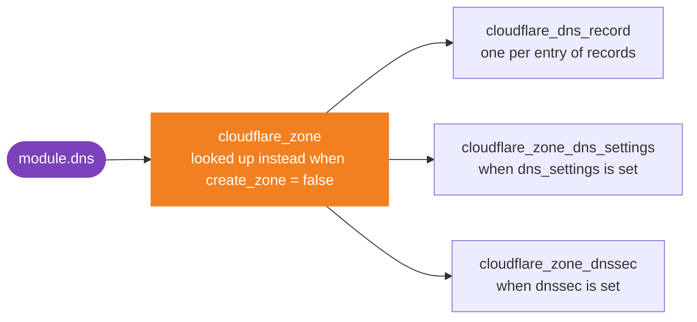
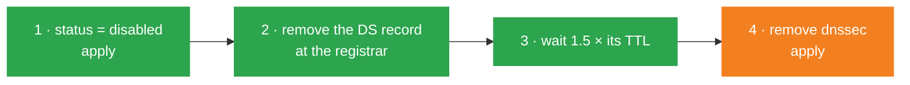

# cloudflare-dns

[](CHANGELOG.md)
[](#requirements)
[](https://registry.terraform.io/providers/cloudflare/cloudflare/latest)
[](../LICENSE)

**A whole Cloudflare DNS zone in one module block: the zone, its records, its
DNS settings and DNSSEC.**

- 🧩 **The provider, unchanged.** Every input keeps its provider attribute
  name. If you know `cloudflare/cloudflare`, you already know this module.
- 🌐 **Create or adopt.** The module creates the zone, or manages what lives in
  a zone another configuration owns.
- 🛡️ **DNSSEC, registrar-ready.** The DS record comes out as an output, whole
  or field by field.
- ✅ **Caught at plan, not at apply.** A record without a value, or proxied with
  a fixed TTL, fails before Cloudflare sees it.

> [!IMPORTANT]
> When the module creates the zone, destroying it deletes the zone, and
> Cloudflare deletes every record in it, including the ones Terraform does not
> manage. Read [Watch out](#watch-out) before your first apply.

**[Quick start](#quick-start)** · **[Inputs](#inputs)** ·
**[Outputs](#outputs)** · **[Watch out](#watch-out)** ·
**[Guides](#guides)** · **[Requirements](#requirements)**

## Quick start

**1. Create an API token** with these two permissions, on all zones of the
account (a zone to be created does not exist yet when you issue the token),
and export it as `CLOUDFLARE_API_TOKEN`:

| Permission | Covers |
|---|---|
| Zone → Zone → Edit | the zone |
| Zone → DNS → Edit | records, DNS settings and DNSSEC |

Adopting a zone another configuration owns takes less, see [Zone](#zone).

**2. Call the module:**

```hcl
module "dns" {
  source = "github.com/theobs-digital/cloudflare-terraform-modules//cloudflare-dns?ref=cloudflare-dns/v1.1.0"

  account_id = "023e105f4ecef8ad9ca31a8372d0c353"
  name       = "example.com"

  records = {
    apex = { name = "@", type = "A", content = "192.0.2.10", proxied = true }
    www  = { name = "www", type = "CNAME", content = "example.com", proxied = true }
    mx   = { name = "@", type = "MX", content = "mx1.example.net", priority = 10 }
    caa  = { name = "@", type = "CAA", data = { flags = 0, tag = "issue", value = "letsencrypt.org" } }
  }
}

output "name_servers" {
  value = module.dns.name_servers
}
```

Find `account_id` in the dashboard, under **API** on a domain's **Overview**
page, or search "Copy account ID" from Account home.

**3. Apply, then delegate.** Set the `name_servers` output at your registrar.
The zone stays `pending` until the registrar delegates the domain.

> [!TIP]
> Always pin `ref` to a tag: without it, Terraform takes the latest commit of
> `main`. The SSH form of `source` and the versioning rules are in the
> [repository README](../README.md#usage).

More in the examples: [basic](examples/basic) (a few records, defaults for
the rest), [complete](examples/complete) (every input) and
[import](examples/import) (an existing zone brought under Terraform without
touching DNS).

### How it works

Each input drives one provider resource. Leave an input out, and the module
creates nothing for it.



## Inputs

| Input | Type | Default | Description |
|---|---|---|---|
| `account_id` | `string` | **required** | Cloudflare account that owns the zone |
| `name` | `string` | **required** | domain of the zone, such as `example.com` |
| `create_zone` | `bool` | `true` | `false` adopts a zone another configuration owns |
| `type` | `string` | `"full"` | `full`, `partial`, `secondary` or `internal` |
| `paused` | `bool` | `false` | `true`: DNS only, no security or performance features |
| `vanity_name_servers` | `list(string)` | — | custom name servers, Business and Enterprise |
| `records` | `map(object)` | `{}` | the DNS records, see [Records](#records) |
| `dns_settings` | `object` | `null` | the DNS settings of the zone, see [DNS settings](#dns-settings) |
| `dnssec` | `object` | `null` | DNSSEC, see [DNSSEC](#dnssec) |

Each block below lists every attribute an input takes, with what it does.
Attributes keep their provider names, and whatever you leave out keeps
Cloudflare's default, except in `dns_settings`.

### Zone

```hcl
# Required. Changing either one replaces the zone.
account_id = "023e105f4ecef8ad9ca31a8372d0c353"  # dashboard: a domain's Overview page, API
name       = "example.com"                       # the domain itself, not app.example.com

# Optional. The values shown are what you get when you leave them out.
create_zone = true    # false: adopt a zone another configuration owns
type        = "full"  # see the table below
paused      = false   # true: Cloudflare DNS only, no security or performance features

# Custom name servers. Business and Enterprise plans only.
vanity_name_servers = ["ns1.example.com", "ns2.example.com"]
```

**`name`** is the domain you registered, `example.com`, not one of its
subdomains such as `app.example.com`. A subdomain gets its own zone only
with a subdomain setup, on Enterprise.

**`type`** sets how Cloudflare serves the domain:

| `type` | When | Plans |
|---|---|---|
| `full` | Cloudflare is the authoritative DNS of the domain. | all |
| `partial` | CNAME setup: your DNS provider stays authoritative, and CNAME records there send the subdomains to proxy to Cloudflare. Prove you own the domain with a TXT record `cloudflare-verify.example.com` holding the `verification_key` output. | Business, Enterprise |
| `secondary` | Cloudflare serves the zone by zone transfer from your primary DNS provider. | Enterprise |
| `internal` | Internal DNS, for private names such as `corp.internal`. | Enterprise, with Cloudflare Gateway |

**`create_zone = false`** adopts a zone another configuration owns: the
module looks it up by `name` in the account, manages only its records, DNS
settings and DNSSEC, and ignores `type`, `paused` and `vanity_name_servers`.
The token then needs less, and on that zone only: Zone → Zone → Read to find
the zone, and Zone → DNS → Edit for the rest.

### Records

`records` is a map. The key is yours and only names the record in the
Terraform state: keep it stable, since
[renaming it](#rename-a-record-key) recreates the record. Here is every
attribute a record takes; a real record sets only those it needs, as in
[Quick start](#quick-start).

```hcl
records = {
  www = {
    name = "www"    # required: "@" for the apex, "www", "www.example.com" or "*"
    type = "CNAME"  # required: one of the 21 types in the table below

    # The value: content or data, never both.
    content = "example.com"  # A, AAAA, CNAME, MX, NS, OPENPGPKEY, PTR, TXT
    # data  = { ... }        # every other type, see the table below

    ttl      = 1             # default 1 (automatic), or 60 to 86400 seconds, 30 minimum on Enterprise
    proxied  = true          # A, AAAA and CNAME only; then ttl stays 1
    priority = 10            # MX, SRV and URI records only
    comment  = "Web front"   # a note for humans, no effect on DNS
    tags     = ["team:web"]  # labels, no effect on DNS. Pro plan and above

    settings = {
      flatten_cname = false  # true needs the Pro plan and above
      ipv4_only     = false  # proxied records only
      ipv6_only     = false  # proxied records only
    }

    private_routing         = false  # private network routing to the origin
    include_shadow_metadata = false  # only fills the provider's computed meta
  }
}
```

The plan fails on a record with neither `content` nor `data`, with both, or
proxied with a `ttl` other than `1`. Only A, AAAA and CNAME records can be
proxied.

**Wildcards**: `name = "*"` covers `*.example.com`, and `name = "*.app"`
covers `*.app.example.com`. They work on every plan, proxied or not, and only
as the first label.

> [!WARNING]
> **A misspelled attribute is dropped without a word.** Terraform discards
> the attributes an input does not declare, in `records` as in `dns_settings`
> or `dnssec`: `proxid = true` leaves the record unproxied, and the plan shows
> no error. Check the names against the blocks on this page.

**The 21 types, and where their value goes:**

| Type | Value |
|---|---|
| A | `content`: an IPv4 address. Can be proxied |
| AAAA | `content`: an IPv6 address. Can be proxied |
| CNAME | `content`: a host name, other than the record's own. Can be proxied |
| MX | `content`: the mail server's host name, plus `priority` at the top level |
| NS | `content`: a name server's host name |
| OPENPGPKEY | `content`: an OpenPGP public key, in Base64 |
| PTR | `content`: the domain name the address points to |
| TXT | `content`: the text |
| CAA | `data`: `flags`, `tag`, `value` |
| CERT | `data`: `type`, `key_tag`, `algorithm`, `certificate` |
| DNSKEY | `data`: `flags`, `protocol`, `algorithm`, `public_key` |
| DS | `data`: `key_tag`, `algorithm`, `digest_type`, `digest` |
| HTTPS, SVCB | `data`: `priority`, `target`, `value` |
| LOC | `data`: `lat_degrees`, `lat_minutes`, `lat_seconds`, `lat_direction`, `long_degrees`, `long_minutes`, `long_seconds`, `long_direction`, `altitude`, `size`, `precision_horz`, `precision_vert` |
| NAPTR | `data`: `order`, `preference`, `flags`, `service`, `regex`, `replacement` |
| SMIMEA, TLSA | `data`: `usage`, `selector`, `matching_type`, `certificate` |
| SRV | `data`: `priority`, `weight`, `port`, `target`, plus `priority` at the top level |
| SSHFP | `data`: `algorithm`, `type`, `fingerprint` |
| URI | `data`: `weight`, `target`, plus `priority` at the top level |

A DNSKEY record needs `dnssec_multi_signer = true` in [`dnssec`](#dnssec):
the module creates records after DNSSEC, so the option is on first.

#### Values Cloudflare rewrites

Cloudflare stores five values its own way. Write them as it stores them, or
each plan shows the difference again:

```diff
  # SRV: priority at the top level too, where Cloudflare returns it
+ priority = 0
  data     = { priority = 0, weight = 0, port = 993, target = "mx1.example.net" }

  # NAPTR: replacement with its final dot
- replacement = "_sip._udp.example.com"
+ replacement = "_sip._udp.example.com."

  # SSHFP: fingerprint in upper case
- fingerprint = "a1b2c3d4e5f6…"
+ fingerprint = "A1B2C3D4E5F6…"

  # HTTPS, SVCB: target with its final dot, unless it is "."
- target = "svc.example.net"
+ target = "svc.example.net."

  # TXT over 255 characters: no quotes, or quoted strings of 255 at most
- content = "\"v=DKIM1; k=rsa; p=MIIBIjANBgkq…\""
+ content = "v=DKIM1; k=rsa; p=MIIBIjANBgkq…"
```

Everything else stays as written: a TXT `content` with or without quotes,
within that limit, an SRV `target` without a final dot, the `value` of an
HTTPS record, the `certificate` of a TLSA record.

#### Names and `settings`

`name` can take any of its three forms: Cloudflare returns the full name, the
provider matches them, and the plan shows no change. A record with `settings`
is the exception: write its `name` in full, or set all three fields of
`settings`, or each plan shows an update of `modified_on`.

```diff
  shop = {
-   name     = "shop"
+   name     = "shop.example.com"
    type     = "CNAME"
    content  = "shops.example.net"
    settings = { flatten_cname = true }
  }
```

### DNS settings

Leave `dns_settings` out, and the module does not touch the zone's DNS
settings. Set it, and the module owns them. The provider reads every setting
back from Cloudflare, so **write the five simple ones**: one left out shows as
a change to `null` at each plan.

```hcl
dns_settings = {
  # Write all five.
  flatten_all_cnames  = false       # flatten every CNAME record of the zone
  multi_provider      = false       # true when another DNS provider serves the zone too
  ns_ttl              = 86400       # TTL of the zone's NS records
  secondary_overrides = false       # proxied overrides on a secondary zone
  zone_mode           = "standard"  # dns_only: serve DNS, never proxy HTTP

  # Optional: leave them out whole, and the plan shows no change.
  nameservers = { type = "cloudflare.standard" }  # cloudflare.advanced: Advanced Nameservers
  # internal_dns = { reference_zone_id = "..." }  # internal zone: the zone to fall back to
  # soa          = { ... }                        # Enterprise only, see below
}
```

These are the values Cloudflare reported for a zone on the Free plan on
11 October 2026. Applied to that zone, the plan then showed no change.
`nameservers` also takes `nameserver_set_id` and `ns_set`, for custom name
server sets.

**`multi_provider`** is for a zone that Cloudflare and another DNS provider
both serve, with both providers' name servers at the registrar. Cloudflare
then activates the zone despite the other provider's name servers, and
answers with the NS records you add at the apex. With DNSSEC, such a zone
needs multi-signer DNSSEC, see [DNSSEC](#dnssec).

**`zone_mode`** takes `standard`, the default; `dns_only`, for a zone that
Cloudflare serves as DNS only, without proxying HTTP; or `cdn_only`, which
Cloudflare does not document.

> [!WARNING]
> **`soa` is for Enterprise zones only.** Elsewhere, Cloudflare refuses any
> `soa`, even its current values, with `Custom SOA records are not available
> to this account or zone` (error 1003), and the apply fails without changing
> anything.

<details>
<summary><b>Enterprise zone: the <code>soa</code> block</b></summary>

Write every field but `mname`: one left out shows as a change to `null` at
each plan. Without `mname`, Cloudflare picks the primary name server itself.
The timers below, like `ns_ttl` above, are the defaults Cloudflare documents
for new zones.

```hcl
soa = {
  expire  = 604800
  min_ttl = 1800
  refresh = 10000
  retry   = 2400
  rname   = "dns.cloudflare.com"
  ttl     = 3600
}
```

</details>

> [!NOTE]
> **No delete, no import.** The provider can neither delete nor import the DNS
> settings. The first apply writes them over the current ones, and its plan
> warns about "Resource Destruction Considerations", which is harmless.
> Removing `dns_settings` only drops them from the state: to go back to a
> default, write it.
>
> **`foundation_dns`** is deprecated and left out of the module: turn Advanced
> Nameservers on with `nameservers = { type = "cloudflare.advanced" }`. The
> module ignores its changes, which before Terraform 1.15 makes `validate` and
> `plan` print a harmless deprecation warning.

### DNSSEC

Leave `dnssec` out, and the module does not touch DNSSEC.

```hcl
dnssec = {
  status              = "active"  # active signs the zone; disabled starts turning it off
  dnssec_multi_signer = false     # multi-signer; needed for your own DNSKEY records
  dnssec_presigned    = false     # transfer in a zone signed elsewhere
  dnssec_use_nsec3    = false     # NSEC3 instead of NSEC
}
```

The provider reads the last three back from Cloudflare: if a plan shows one
going to `null`, write the value it had. To switch DNSSEC on or off, follow
[Turn DNSSEC on](#turn-dnssec-on) and [Turn DNSSEC off](#turn-dnssec-off).

## Outputs

| Output | Use it for |
|---|---|
| `name_servers` | 👉 the registrar: delegate the domain to these name servers |
| `dnssec` | 👉 the registrar: the DS record, see [Turn DNSSEC on](#turn-dnssec-on). `null` without `dnssec` |
| `zone_id` | other resources and modules working on the zone |
| `name` | the domain name of the zone |
| `status` | `pending` until the domain is delegated, then `active` |
| `verification_key` | a partial zone setup |
| `record_ids` | the IDs of the records, by key of `records` |

## Watch out

**🔴 Can delete data or break DNS**

- **Destroying the module, or changing `name` or `account_id`**, when the
  module created the zone, deletes the zone and every record in it. Before
  applying, look for `module.dns.cloudflare_zone.this[0]` in the plan.
- **Switching `create_zone` from `true` to `false`** destroys the zone. Forget
  it first, see [Stop managing without deleting](#stop-managing-without-deleting).
- **Removing `dnssec`** while resolvers can still find the DS record makes
  them answer `SERVFAIL`. Follow [Turn DNSSEC off](#turn-dnssec-off).

**🟠 Surprises at apply**

- **Renaming a key of `records`** deletes the record and creates it again.
  Declare the move, see [Rename a record key](#rename-a-record-key).
- **Writing `soa` outside Enterprise** fails with error 1003. Leave it out.
- **Paid features on the Free plan** fail: record `tags`,
  `settings.flatten_cname = true` and `vanity_name_servers`.
- **A misspelled attribute**, such as `proxid`, is dropped without an error:
  the apply goes ahead without it. See [Records](#records).

**🟡 A change at every plan**

- A simple DNS setting, or a field of `soa`, left out: write them all, see
  [DNS settings](#dns-settings).
- An SRV, NAPTR, SSHFP, HTTPS or SVCB record written your own way, or a
  quoted TXT string over 255 characters: see
  [Values Cloudflare rewrites](#values-cloudflare-rewrites).
- A record with `settings`, a short `name` and not all three fields: see
  [Names and `settings`](#names-and-settings).

**🔵 Harmless, good to know**

- Removing `dns_settings` resets nothing: the zone keeps the last values
  applied.
- Until the registrar catches up with a DNSSEC change, each plan shows
  `status` changing, and applying does nothing.
- Before Terraform 1.15, `dns_settings` brings a deprecation warning about
  `foundation_dns`.

## Guides

### Adopt an existing zone

When another configuration manages the zone, set `create_zone = false`: the
module looks the zone up by `name` and manages only what you declare in it.

To bring an existing zone and its records under this module without touching
DNS, follow the [import example](examples/import): `import` blocks, with each
record ID looked up by name, type and content.

### Share values between records

The module has no defaults of its own for records. To give many records the
same values, merge them in your configuration: a value the record sets wins.
A default can depend on the type, as `proxied` here, which only A, AAAA and
CNAME records take.

```hcl
locals {
  records = {
    apex = { name = "@", type = "A", content = "192.0.2.10" }
    www  = { name = "www", type = "CNAME", content = "example.com" }
    mx   = { name = "@", type = "MX", content = "mx1.example.net", priority = 10 }
  }
}

module "dns" {
  # ...
  records = {
    for key, record in local.records : key => merge({
      comment = "Managed by Terraform"
      proxied = contains(["A", "AAAA", "CNAME"], record.type) ? true : null
    }, record)
  }
}
```

### Keep the records in YAML

`records` takes the same map from a YAML file. Quote `"@"`, which YAML
reserves at the start of a value. A misspelled key is dropped there too, see
[Records](#records).

```hcl
module "dns" {
  # ...
  records = yamldecode(file("${path.module}/dns.yaml"))
}
```

```yaml
apex:
  name: "@"
  type: A
  content: 192.0.2.10
  proxied: true
caa:
  name: "@"
  type: CAA
  data:
    flags: 0
    tag: issue
    value: letsencrypt.org
```

### Email records: SPF, DKIM and DMARC

The module has no input of its own for email: SPF, DKIM and DMARC are TXT
records in `records`, with the values your mail provider gives.

```hcl
records = {
  # SPF: the servers allowed to send mail for the domain. One per name.
  spf = { name = "@", type = "TXT", content = "\"v=spf1 include:_spf.example.net -all\"" }

  # DKIM: the public key of a selector, here s1. No quotes, see below.
  dkim = { name = "s1._domainkey", type = "TXT", content = "v=DKIM1; k=rsa; p=MIIBIjANBgkqhkiG9w0BAQEFAAOCAQ8AMIIBCgKCAQEA…" }

  # DMARC: what receivers do with mail that fails SPF and DKIM.
  dmarc = { name = "_dmarc", type = "TXT", content = "\"v=DMARC1; p=reject; rua=mailto:dmarc@example.com\"" }
}
```

A 2048-bit DKIM key makes a value over 255 characters, the most one string of
a TXT record holds. Write it without quotes: Cloudflare keeps it as written,
and serves it split into strings of 255 characters, which DKIM joins back.
Or split it yourself into quoted strings of 255 characters at most. Within
one pair of quotes, Cloudflare splits it, and each plan shows the difference
again. Some mail providers publish DKIM as a CNAME record to their own TXT
record instead: declare that CNAME.

A domain that sends no mail can still say so, and ask receivers to reject
any mail in its name:

```hcl
  spf   = { name = "@", type = "TXT", content = "\"v=spf1 -all\"" }
  dmarc = { name = "_dmarc", type = "TXT", content = "\"v=DMARC1; p=reject\"" }
```

### Rename a record key

Renaming a key deletes the record and creates it again, both at the same
time. To rename a key without touching DNS, declare the move:

```hcl
moved {
  from = module.dns.cloudflare_dns_record.this["old"]
  to   = module.dns.cloudflare_dns_record.this["new"]
}
```

### Stop managing without deleting

**The whole module.** Remove the `module` block and declare its removal
(Terraform 1.7 or later). The plan then shows each object as "will no longer
be managed by Terraform, but will not be destroyed". Before Terraform 1.7,
run `terraform state rm module.dns` instead.

```hcl
removed {
  from = module.dns

  lifecycle {
    destroy = false
  }
}
```

**Part of it.** A `removed` block cannot target a resource the module still
declares, nor one key of `records`: use `terraform state rm`.

- To hand the zone over to another configuration and keep the records here,
  forget the zone, then set `create_zone = false`. The plan shows no change.

  ```bash
  terraform state rm 'module.dns.cloudflare_zone.this[0]'
  ```

- To leave one record alone, forget it, then remove its entry from `records`.

  ```bash
  terraform state rm 'module.dns.cloudflare_dns_record.this["www"]'
  ```

### Turn DNSSEC on

1. Set `dnssec = { status = "active" }` and apply. Cloudflare signs the zone
   and computes its DS record.
2. Give the DS record to the registrar, from the `dnssec` output: whole in
   `ds`, or as `key_tag`, `algorithm`, `digest_type` and `digest`. Some
   registrars ask for the DNSKEY record instead: `flags`, `algorithm` and
   `public_key`. Cloudflare Registrar, and `.ch` and `.cz` domains, get it
   without you.

Until Cloudflare finds the DS record at the registrar, DNSSEC is `pending`,
and each plan shows `status` going from `"pending"` to `"active"`. Applying
changes nothing; the difference goes away once the DS record is published.

### Turn DNSSEC off

> [!CAUTION]
> **Never just remove `dnssec`.** Cloudflare would stop signing the zone at
> once, and resolvers that validate DNSSEC fail on the domain (`SERVFAIL`) as
> long as they still find its DS record, at the registrar or in their cache.
> Cloudflare refuses the deletion while the DS record is at the registrar, but
> it cannot see the caches. Go through the registrar first.



1. Set `status = "disabled"` and apply. Cloudflare keeps signing the zone, so
   nothing breaks, and publishes CDS and CDNSKEY records that ask the
   registrar to remove the DS record
   ([RFC 8078](https://www.rfc-editor.org/rfc/rfc8078.html#section-4)). Until
   it is gone, Cloudflare reports `pending-disabled`, and each plan shows
   `status` going from `"pending-disabled"` to `"disabled"`.
2. Note the TTL of the DS record, then remove it at the registrar. Cloudflare
   Registrar removes it on its own after step 1.
3. Wait until the parent zone no longer serves the DS record, then at least
   1.5 times its TTL, as Cloudflare advises, for resolvers to drop it from
   their caches:

   ```bash
   # Name servers of the parent zone, here .com
   dig +short NS com.
   # No answer once the DS record is removed
   dig +norecurse +noall +answer DS example.com @a.gtld-servers.net
   ```

4. Remove `dnssec` and apply. Keeping `dnssec = { status = "disabled" }`
   instead leaves the zone signed with its DNSKEY records published: resolvers
   ignore them without a DS record, though some audit tools flag them.

## Requirements

| | Version | Checked with |
|---|---|---|
| Terraform | `>= 1.3`, the first that accepts a default in `optional()` | 1.3.10 and 1.16.5 |
| Provider [`cloudflare/cloudflare`](https://registry.terraform.io/providers/cloudflare/cloudflare/latest) | `~> 5.27` | 5.27.0 and 5.28.0 |

`removed` blocks and the [import example](examples/import) need Terraform 1.7
or later. The provider reads its API token from the `CLOUDFLARE_API_TOKEN`
environment variable, with the permissions listed in
[Quick start](#quick-start).

## Reference

<details>
<summary><b>Every input and output, with its full type</b> (generated by terraform-docs)</summary>

<!-- BEGIN_TF_DOCS -->
### Resources

The following resources are used by this module:

- [cloudflare_dns_record.this](https://registry.terraform.io/providers/cloudflare/cloudflare/latest/docs/resources/dns_record) (resource)
- [cloudflare_zone.this](https://registry.terraform.io/providers/cloudflare/cloudflare/latest/docs/resources/zone) (resource)
- [cloudflare_zone_dns_settings.this](https://registry.terraform.io/providers/cloudflare/cloudflare/latest/docs/resources/zone_dns_settings) (resource)
- [cloudflare_zone_dnssec.this](https://registry.terraform.io/providers/cloudflare/cloudflare/latest/docs/resources/zone_dnssec) (resource)
- [cloudflare_zone.this](https://registry.terraform.io/providers/cloudflare/cloudflare/latest/docs/data-sources/zone) (data source)

### Required Inputs

The following input variables are required:

#### <a name="input_account_id"></a> [account\_id](#input\_account\_id)

Description: ID of the Cloudflare account that owns the zone.

Type: `string`

#### <a name="input_name"></a> [name](#input\_name)

Description: Domain name of the zone, such as `example.com`. Changing it replaces the zone.

Type: `string`

### Optional Inputs

The following input variables are optional (have default values):

#### <a name="input_create_zone"></a> [create\_zone](#input\_create\_zone)

Description: Whether the module creates the zone. Set it to `false` when the zone already exists and another configuration manages it: the module then looks the zone up by `name` in the account, manages only its records, DNS settings and DNSSEC, and ignores `type`, `paused` and `vanity_name_servers`.

Type: `bool`

Default: `true`

#### <a name="input_dns_settings"></a> [dns\_settings](#input\_dns\_settings)

Description: DNS settings of the zone, with the attributes of `cloudflare_zone_dns_settings` under the same names, except the deprecated `foundation_dns`. When `null`, the module leaves them alone. Write `flatten_all_cnames`, `multi_provider`, `ns_ttl`, `secondary_overrides` and `zone_mode`: one left out shows as a change to `null` at each plan. `soa` is only accepted on Enterprise zones: elsewhere the API refuses it, even unchanged (error 1003). Leave it out, and the plan shows no change: the provider reads it back from Cloudflare. Removing this argument resets nothing, see [DNS settings](#dns-settings).

Type:

```hcl
object({
    flatten_all_cnames = optional(bool)
    internal_dns = optional(object({
      reference_zone_id = optional(string)
    }))
    multi_provider = optional(bool)
    nameservers = optional(object({
      type              = string
      nameserver_set_id = optional(string)
      ns_set            = optional(number)
    }))
    ns_ttl              = optional(number)
    secondary_overrides = optional(bool)
    soa = optional(object({
      expire  = optional(number)
      min_ttl = optional(number)
      mname   = optional(string)
      refresh = optional(number)
      retry   = optional(number)
      rname   = optional(string)
      ttl     = optional(number)
    }))
    zone_mode = optional(string)
  })
```

Default: `null`

#### <a name="input_dnssec"></a> [dnssec](#input\_dnssec)

Description: DNSSEC of the zone, with the attributes of `cloudflare_zone_dnssec` under the same names. When `null`, the module leaves DNSSEC alone. Set `status = "active"` to sign the zone, then give the `dnssec` output to the registrar. Removing this argument deletes the DNSSEC keys: remove the DS record at the registrar first, see [Turn DNSSEC off](#turn-dnssec-off).

Type:

```hcl
object({
    status              = optional(string)
    dnssec_multi_signer = optional(bool)
    dnssec_presigned    = optional(bool)
    dnssec_use_nsec3    = optional(bool)
  })
```

Default: `null`

#### <a name="input_paused"></a> [paused](#input\_paused)

Description: Whether the zone only uses Cloudflare DNS, without the security and performance features. When `null`, the provider sets `false`.

Type: `bool`

Default: `null`

#### <a name="input_records"></a> [records](#input\_records)

Description: DNS records of the zone, by a key of your choice. The key only names the record in the state: keep it stable, since renaming a key replaces the record. Each record takes the attributes of `cloudflare_dns_record` under the same names, and `ttl` defaults to `1` (automatic). Set `content` for A, AAAA, CNAME, MX, NS, OPENPGPKEY, PTR and TXT records, `data` for the other types.

Type:

```hcl
map(object({
    name    = string
    type    = string
    ttl     = optional(number, 1)
    content = optional(string)
    data = optional(object({
      algorithm      = optional(number)
      altitude       = optional(number)
      certificate    = optional(string)
      digest         = optional(string)
      digest_type    = optional(number)
      fingerprint    = optional(string)
      flags          = optional(any)
      key_tag        = optional(number)
      lat_degrees    = optional(number)
      lat_direction  = optional(string)
      lat_minutes    = optional(number)
      lat_seconds    = optional(number)
      long_degrees   = optional(number)
      long_direction = optional(string)
      long_minutes   = optional(number)
      long_seconds   = optional(number)
      matching_type  = optional(number)
      order          = optional(number)
      port           = optional(number)
      precision_horz = optional(number)
      precision_vert = optional(number)
      preference     = optional(number)
      priority       = optional(number)
      protocol       = optional(number)
      public_key     = optional(string)
      regex          = optional(string)
      replacement    = optional(string)
      selector       = optional(number)
      service        = optional(string)
      size           = optional(number)
      tag            = optional(string)
      target         = optional(string)
      type           = optional(number)
      usage          = optional(number)
      value          = optional(string)
      weight         = optional(number)
    }))
    proxied  = optional(bool)
    priority = optional(number)
    comment  = optional(string)
    tags     = optional(set(string))
    settings = optional(object({
      flatten_cname = optional(bool)
      ipv4_only     = optional(bool)
      ipv6_only     = optional(bool)
    }))
    private_routing         = optional(bool)
    include_shadow_metadata = optional(bool)
  }))
```

Default: `{}`

#### <a name="input_type"></a> [type](#input\_type)

Description: Type of the zone: `full`, `partial`, `secondary` or `internal`. When `null`, the provider sets `full`.

Type: `string`

Default: `null`

#### <a name="input_vanity_name_servers"></a> [vanity\_name\_servers](#input\_vanity\_name\_servers)

Description: Custom name servers of the zone. Business and Enterprise plans only.

Type: `list(string)`

Default: `null`

### Outputs

The following outputs are exported:

#### <a name="output_dnssec"></a> [dnssec](#output\_dnssec)

Description: DNSSEC of the zone, or `null` when the module does not manage it. Give the registrar the DS record, whole in `ds` or as its fields `key_tag`, `algorithm`, `digest_type` and `digest`. Some registrars ask for the DNSKEY record instead: `flags`, `algorithm` and `public_key`.

#### <a name="output_name"></a> [name](#output\_name)

Description: Domain name of the zone.

#### <a name="output_name_servers"></a> [name\_servers](#output\_name\_servers)

Description: Name servers Cloudflare assigned to the zone, to set at the registrar.

#### <a name="output_record_ids"></a> [record\_ids](#output\_record\_ids)

Description: IDs of the DNS records, by key of `records`.

#### <a name="output_status"></a> [status](#output\_status)

Description: Status of the zone: `initializing`, `pending`, `active` or `moved`. A new full zone stays `pending` until the registrar delegates the domain to `name_servers`.

#### <a name="output_verification_key"></a> [verification\_key](#output\_verification\_key)

Description: Verification key for a partial zone setup.

#### <a name="output_zone_id"></a> [zone\_id](#output\_zone\_id)

Description: ID of the zone.
<!-- END_TF_DOCS -->

</details>

## Development

See the [repository README](../README.md#development) for the tools and the
checks.
