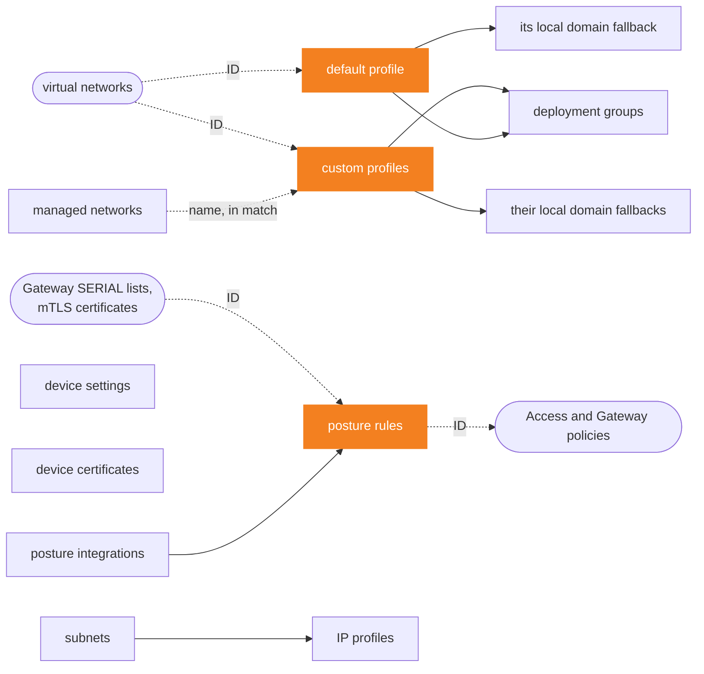

# cloudflare-zero-trust-devices

[](CHANGELOG.md)
[](#requirements)
[](https://registry.terraform.io/providers/cloudflare/cloudflare/latest)
[](../LICENSE)

**The devices of Cloudflare Zero Trust in one module block: the WARP client
settings, the default and custom device profiles with their local domain
fallback, managed networks, device posture integrations and rules, device IP
subnets and profiles, and the client versions of deployment groups.**

- 🧩 **The provider, unchanged.** 12 resources, every attribute that is not
  deprecated, under its provider name: device certificates, IP profiles and
  deployment groups included. If you know `cloudflare/cloudflare`, you
  already know this module.
- 🔗 **Linked through its outputs.** A local domain fallback takes the ID of
  its profile, an IP profile the ID of its subnet, a deployment group the IDs
  of its profiles, the default one included, and Terraform orders the
  requests as Cloudflare requires.
- 📥 **Adopt what exists.** The import example brings the default profile,
  custom profiles, managed networks, posture rules, IP profiles and their
  fallbacks under Terraform by name, without a change.
- 🔬 **Checked against the real API.** What Cloudflare refuses, resets or
  never returns was observed on a Zero Trust organization on the Free plan,
  with provider 5.28.0, and is written here.

> [!IMPORTANT]
> `device_settings`, `device_default_profile` and its local domain fallback
> act on every device of the account. Removing `device_settings` **resets the
> device settings** of the account, and a first apply of the default profile
> without `import` writes the provider defaults over its values. Read
> [Watch out](#watch-out) before your first apply.

**[Quick start](#quick-start)** · **[Inputs](#inputs)** ·
**[Outputs](#outputs)** · **[Watch out](#watch-out)** ·
**[Guides](#guides)** · **[Requirements](#requirements)**

## Quick start

**1. Create the Zero Trust organization** in the Cloudflare One dashboard, if
the account has none. This module does not create it, and is tested with one.

**2. Create an API token** with these permissions, as the Cloudflare API
schema lists them for each call of the provider, and export it as
`CLOUDFLARE_API_TOKEN`. Grant only those of the inputs you use:

| Permission | Covers |
|---|---|
| Account → Zero Trust → Edit | device settings, default and custom profiles, their local domain fallbacks, managed networks, posture integrations and rules, IP profiles, deployment groups |
| Account → Cloudflare One Networks → Edit | `device_subnets` |
| Zone → SSL and Certificates → Edit | `device_default_profile_certificates`, on each zone it lists |

The API schema lists no permission for deployment groups, and Cloudflare's
documentation names Zero Trust → Edit. The module is tested with a broader
token.

**3. Call the module:**

```hcl
module "devices" {
  source = "github.com/theobs-digital/cloudflare-terraform-modules//cloudflare-zero-trust-devices?ref=cloudflare-zero-trust-devices/v1.0.0"

  account_id = "023e105f4ecef8ad9ca31a8372d0c353"

  device_posture_rules = {
    macos_version = {
      name     = "macOS 15 or later"
      type     = "os_version"
      schedule = "5m"
      match    = [{ platform = "mac" }]
      input    = { version = "15.0.0", operator = ">=" }
    }
  }

  device_custom_profiles = {
    engineering = {
      name            = "Engineering"
      match           = "identity.groups.name == \"Engineering\""
      precedence      = 100
      switch_locked   = true
      tunnel_protocol = "masque"
    }
  }
}

output "device_posture_rule_ids" {
  value = module.devices.device_posture_rule_ids
}
```

Find `account_id` in the dashboard, under **API** on a domain's **Overview**
page, or search "Copy account ID" from Account home.

**4. Apply, then require the rule** in Access and Gateway policies, by the ID
that `device_posture_rule_ids` gives, see
[Require a posture check](#require-a-posture-check). Devices of the
Engineering group take the profile; the others keep the default profile.

> [!TIP]
> The module comes from Git, with a release tag in `ref`, see the
> [repository README](../README.md#usage). It is not on the Terraform Registry
> yet.

More in the examples: [basic](examples/basic) (two posture rules and a
profile), [complete](examples/complete) (every input) and
[import](examples/import) (an existing setup brought under Terraform without
changing it).

### How it works

The module works at the account level, except device certificates, which are
set by zone. Each input drives one provider resource: one per entry of a map,
or a single one for `device_settings`, `device_default_profile` and
`device_default_profile_local_domain_fallback`. Leave an input out, and the
module creates nothing for it; leave one of these three out, and the module
leaves it alone.

Objects refer to each other through the module's outputs, such as
`policy_id = module.devices.device_custom_profile_ids["engineering"]`: the
attribute keeps the provider's meaning, an ID, whether the object lives in
this module block or elsewhere. A solid arrow goes from an object to those
that take its ID in the same block, a dotted one to what takes it outside the
module, or to a reference by name:



Two consequences, both from how Terraform orders the work, by input and by
output rather than by entry:

- **Terraform creates an object after the objects whose IDs it takes, and
  deletes it before them**, which Cloudflare requires: it refuses to delete a
  subnet that an IP profile uses (error 1121). With an ID written by hand,
  Terraform does not know the link.
- **Every entry of an input waits for every object behind each output its
  entries refer to.** When one of them fails, Terraform creates none of these
  entries. The module also updates every custom profile before any local
  domain fallback, see
  [Local domain fallback of custom profiles](#local-domain-fallback-of-custom-profiles):
  a profile that fails holds every fallback back.

### Why a module

Cloudflare's [Terraform best practices](https://developers.cloudflare.com/terraform/advanced-topics/best-practices/#avoid-modules-or-use-them-sparingly)
advise to avoid modules, or to use them sparingly: a module that hides
resources behind its own logic can change them in ways its caller does not
see, and adds its own bugs to those of Terraform and the provider. This one
has almost no logic of its own. Each entry is one provider resource, with the
provider's attributes, and the plan shows the provider's resources as they
are, under `module.devices`. The module adds three things, each one after a
test against the API showed it was missing: the order between profiles and
their fallbacks, `create_before_destroy` on subnets, and an empty `sha256` by
default on managed networks. The rest is the typing of every attribute, the
references between objects, and what this README records of the API.

## Inputs

| Input | Type | Default | Description |
|---|---|---|---|
| `account_id` | `string` | **required** | the account that owns the Zero Trust organization |
| `device_settings` | `object` | `null` | Gateway proxy, root certificate, virtual IPs, override code and emergency disconnect of the account, see [Settings](#settings) |
| `device_default_profile` | `object` | `null` | the profile of devices no custom profile matches, see [Default profile](#default-profile) |
| `device_default_profile_local_domain_fallback` | `object` | `null` | domains that devices on the default profile resolve with their local DNS, see [Local domain fallback](#local-domain-fallback) |
| `device_default_profile_certificates` | `map(object)` | `{}` | the client certificate WARP installs, by zone, see [Device certificates](#device-certificates) |
| `device_custom_profiles` | `map(object)` | `{}` | device profiles chosen by user, device or network, see [Custom profiles](#custom-profiles) |
| `device_custom_profile_local_domain_fallbacks` | `map(object)` | `{}` | domains resolved locally, by custom profile, see [Local domain fallback of custom profiles](#local-domain-fallback-of-custom-profiles) |
| `device_managed_networks` | `map(object)` | `{}` | networks WARP recognizes by a TLS host, see [Managed networks](#managed-networks) |
| `device_posture_integrations` | `map(object)` | `{}` | third-party services that rate devices, see [Posture integrations](#posture-integrations) |
| `device_posture_rules` | `map(object)` | `{}` | checks that policies require of a device, see [Posture rules](#posture-rules) |
| `device_subnets` | `map(object)` | `{}` | ranges devices take their IP from, see [Subnets and IP profiles](#subnets-and-ip-profiles) |
| `device_ip_profiles` | `map(object)` | `{}` | which subnet a device takes its IP from, see [Subnets and IP profiles](#subnets-and-ip-profiles) |
| `device_deployment_groups` | `map(object)` | `{}` | the WARP client version of the devices of some profiles, see [Deployment groups](#deployment-groups) |

The key of a map is yours and only names the object in the Terraform state:
keep it stable, since [renaming it](#rename-a-key) replaces the object, with a
new ID. Each block below shows the attributes an input takes, with what they
do; the full type of every input is in the [Reference](#reference).
Attributes keep their provider names. `account_id` replaces every object of
the module when it changes.

> [!WARNING]
> **A misspelled attribute is dropped without a word.** Terraform discards
> the attributes an input does not declare: `switch_lock = true` leaves the
> switch unlocked, and the plan shows no error. Check the names against the
> blocks on this page.

> [!NOTE]
> **The state holds the secrets** of posture integrations, in clear text, as
> it does any attribute. Keep the state in an encrypted backend, with
> restricted access, and pass the secrets through sensitive variables, see
> [Posture integrations](#posture-integrations).

### Settings

The device settings of the whole account.

```hcl
device_settings = {
  gateway_proxy_enabled                 = true   # Gateway proxy filtering on TCP
  gateway_udp_proxy_enabled             = true   # Gateway proxy filtering on UDP
  root_certificate_installation_enabled = false  # the client installs the Cloudflare managed root certificate
  use_zt_virtual_ip                     = true   # CGNAT virtual IPv4 for devices
  disable_for_time                      = 0      # seconds a user can bypass the client with an override code

  # Emergency disconnect: the clients poll an HTTPS URL of yours, whose host is an IP address.
  external_emergency_signal_enabled     = true
  external_emergency_signal_url         = "https://192.0.2.10/warp-signal"
  external_emergency_signal_fingerprint = "<64 hex characters>"  # SHA-256 of its certificate; other certificates are ignored
  external_emergency_signal_interval    = "5m"                   # 30s at least
}
```

The provider cannot import the settings: the first apply writes them with
`PUT /accounts/{account_id}/devices/settings`, and Cloudflare keeps the
fields the request leaves out. The provider then reads every field back. A
field that Cloudflare returns and the configuration leaves out shows as a
change to `null` at each plan, and Cloudflare refuses the `null` with
`invalid account settings request` (error 2024, provider issue
[#7100](https://github.com/cloudflare/terraform-provider-cloudflare/issues/7100)):
the apply fails without changing anything. **Write every field Cloudflare
returns.** Read them before the first apply:

```bash
curl -s "https://api.cloudflare.com/client/v4/accounts/$ACCOUNT_ID/devices/settings" \
  -H "Authorization: Bearer $CLOUDFLARE_API_TOKEN"
```

On 17 October 2026, Cloudflare returned these values for an organization on
the Free plan, which had never set the `external_emergency_signal_*` fields,
and this block, applied to it, then planned no change:

```hcl
device_settings = {
  disable_for_time                      = 0
  gateway_proxy_enabled                 = true
  gateway_udp_proxy_enabled             = true
  root_certificate_installation_enabled = false
  use_zt_virtual_ip                     = true
}
```

> [!CAUTION]
> **Removing `device_settings` resets the device settings.** The provider
> calls `DELETE /accounts/{account_id}/devices/settings`. On 17 October 2026,
> the reset set `disable_for_time = 0`, `gateway_udp_proxy_enabled = true`,
> `root_certificate_installation_enabled = false` and `use_zt_virtual_ip =
> true`, whatever they were before; `gateway_proxy_enabled`, `true` before,
> stayed `true`. To stop managing the settings and keep their values, see
> [Stop managing without deleting](#stop-managing-without-deleting).

### Default profile

The profile of every device that no custom profile matches. It always
exists, so the module never creates it: **adopt it with an `import` block**,
whose ID is the account ID.

```hcl
import {
  to = module.devices.cloudflare_zero_trust_device_default_profile.this[0]
  id = "023e105f4ecef8ad9ca31a8372d0c353"
}
```

It takes the attributes below, which [custom profiles](#custom-profiles)
take too. The comments give the provider default of each one that has one:

```hcl
device_default_profile = {
  # How the client connects
  tunnel_protocol = "masque"              # default "": wireguard or masque
  service_mode_v2 = { mode = "warp" }     # the client mode; proxy also takes a port
  auto_connect    = 0                     # default 0: seconds before the client reconnects after it was turned off
  captive_portal  = 180                   # default 180: time after which the captive portal turns on

  # What the user may do
  switch_locked        = false  # default false: true keeps users from turning the client off
  allow_mode_switch    = false  # default false: let users switch modes
  allow_updates        = false  # default false: notify users of new client versions
  allowed_to_leave     = true   # default true: let users leave the organization
  uninstall_protection = false  # default false: an override code to uninstall (Windows only)
  support_url          = ""     # default "": the page of the Send Feedback button

  # What goes through the client: exclude or include, never both
  exclude            = [{ address = "192.168.0.0/16", description = "Home networks" }, { host = "example.net" }]
  exclude_office_ips    = false  # default false: add Microsoft IPs to the exclusions
  lan_allow_minutes     = 30     # minutes a user may reach their LAN; 0: until the client reconnects
  lan_allow_subnet_size = 24     # size of the LAN subnet they may reach

  # DNS
  dns_search_suffixes            = [{ suffix = "corp.example.com" }]
  disable_auto_fallback          = false  # default false: true keeps fallback domains without dns_server from the system resolvers
  register_interface_ip_with_dns = true   # default true: register the client's IP with the on-premises DNS
  sccm_vpn_boundary_support      = false  # default false: tell SCCM the device is inside the VPN boundary (Windows only)

  # IDs of virtual networks, such as the tunnel_cloudflared_virtual_network_ids output of cloudflare-zero-trust-networks
  virtual_networks = { allowed = ["<id>", "<id>"], default = "<id>" }  # default must be one of allowed

  # Only once Cloudflare turned it on for the account, through the account team
  global_acceleration = { enabled = true, api_endpoints = [], masque_endpoints = [], wireguard_endpoints = [] }
}
```

Without `import`, the first apply writes the provider default of each
attribute with one that the configuration leaves out, over the value
Cloudflare holds. After an import, the plan shows these defaults as changes
wherever Cloudflare holds another value: **write the value Cloudflare
holds**. `exclude`, `include`, `service_mode_v2` and `dns_search_suffixes`
have no default and keep Cloudflare's value when left out. Write them anyway
as Cloudflare holds them: while one of them is left out and Cloudflare holds
a value for it, each plan shows the default profile updated in place,
`policy_id` going to `(known after apply)` and nothing else, and the apply
sends an empty update. To clear `dns_search_suffixes`, write `[]`.

On 17 October 2026, Cloudflare returned this default profile for an
organization on the Free plan, and with this block, the import planned no
change:

```hcl
device_default_profile = {
  tunnel_protocol = "masque"
  service_mode_v2 = { mode = "warp" }
  exclude = [
    { address = "10.0.0.0/8" },
    { address = "100.64.0.0/10" },
    { address = "169.254.0.0/16", description = "DHCP Unspecified" },
    { address = "172.16.0.0/12" },
    { address = "192.0.0.0/24" },
    { address = "192.168.0.0/16" },
    { address = "224.0.0.0/24" },
    { address = "240.0.0.0/4" },
    { address = "255.255.255.255/32", description = "DHCP Broadcast" },
    { address = "fe80::/10", description = "IPv6 Link Local" },
    { address = "fd00::/8" },
    { address = "ff01::/16" },
    { address = "ff02::/16" },
    { address = "ff03::/16" },
    { address = "ff04::/16" },
    { address = "ff05::/16" },
  ]
}
```

On 18 October 2026, replacing these 16 exclusions with 3, then writing them
back, applied each time with no change at the next plan.
`global_acceleration` is tested with a mock provider only.

The ID of the resource is the account ID. The profile also has its own
`policy_id`, which `device_default_profile_policy_id` gives, for
[deployment groups](#deployment-groups). Removing `device_default_profile`
only drops the profile from the state: the apply sends no request, and
Cloudflare keeps the profile as last applied. The plan warns about "Resource
Destruction Considerations", as it does when it creates the profile without
`import`; the warning is harmless.

#### Local domain fallback

The domains that devices on the default profile resolve with their local
DNS, outside Gateway. Adopt the list with an `import` block, whose ID is the
account ID, like the default profile.

```hcl
device_default_profile_local_domain_fallback = {
  domains = [                       # required: the whole list, in any order
    {
      suffix      = "corp.example.com"  # required
      description = "Internal zone"
      dns_server  = ["10.0.0.53"]       # left out: the system resolvers
    },
    { suffix = "local" },
  ]
}
```

**`domains` is the whole list**: each apply replaces it, and a domain left
out is removed, Cloudflare's default domains included. The organization
tested on 17 October 2026 held the 14 domains that Cloudflare recommends by
default. With them, the import planned no change:

```hcl
device_default_profile_local_domain_fallback = {
  domains = [for suffix in [
    "home.arpa", "intranet", "internal", "private", "localdomain", "domain", "lan",
    "home", "host", "corp", "local", "localhost", "invalid", "test",
  ] : { suffix = suffix }]
}
```

The default profile returns these domains in `fallback_domains`. When an
apply changes both, the module updates the profile first. In the other order,
or in parallel, the profile update fails with "Provider produced inconsistent
result after apply", since its `fallback_domains` changed during the apply;
in parallel, Cloudflare also answers `policy was modified concurrently`
(error 2077), which the provider retries.

Removing `device_default_profile_local_domain_fallback` only drops the list
from the state: the apply sends no request, and Cloudflare keeps the domains
as last applied.

### Device certificates

Turns on, for each zone listed, the client certificate that WARP installs on
devices for mTLS. Each entry takes a key of your choice, so a zone created in
the same configuration, whose ID is unknown until the apply, can be listed:

```hcl
device_default_profile_certificates = {
  example = {
    zone_id = cloudflare_zone.example.id  # required
    enabled = true                        # required
  }
}
```

The provider cannot import this setting: the first apply writes `enabled`,
and the plan warns about "Resource Destruction Considerations"; the warning
is harmless. **Removing an entry only drops it from the state**: the apply
sends no request, and the zone keeps the setting as last applied. To turn
the certificate off, apply `enabled = false` before removing the entry.

### Custom profiles

A device takes the first custom profile whose `match` is true, in increasing
`precedence`; the default profile comes last.

```hcl
device_custom_profiles = {
  engineering = {
    name         = "Engineering"                            # required
    match        = "identity.groups.name == \"Engineering\""  # required by Cloudflare
    precedence   = 100                                      # required by Cloudflare; unique among custom profiles
    description  = ""                                       # default ""
    enabled      = true                                     # default true
    profile_type = "warp"                                   # default warp; changing it replaces the profile
    # browser_extension_config = { proxy_control = "unlocked", proxy_enabled = true }  # browser_extension profiles only

    # Then the attributes of the default profile, with the same defaults.
    tunnel_protocol = "masque"
    switch_locked   = true
  }
}
```

Cloudflare requires `name`, `match` and `precedence` to create a profile,
although the provider marks `match` and `precedence` optional: without them,
the apply fails with `missing fields in policy` (error 2072).

**`match`** is a wirefilter expression on the identity of the user
(`identity.email`, `identity.groups.id`, `identity.groups.name`,
`identity.groups.email`, `identity.saml_attributes`,
`identity.service_token_uuid`), the device (`os.name`, `os.version`,
`device.tags`) or the managed network the device is on, by its name
(`network == "Office"`, see [Managed networks](#managed-networks)). A group
ID can come from the `access_group_ids` output of the
`cloudflare-zero-trust-access` module.

**`precedence`** must be unique among custom profiles at each request:
Cloudflare refuses a value that another profile holds with `policy precedence
must be unique and positive for non-default policies` (error 2070), on
creation as on update. See [Reorder profiles](#reorder-profiles).

A profile the module creates takes the provider defaults of the attributes
left out, which are Cloudflare's values for a new profile, and plans no
change afterwards. On 17 October 2026, Cloudflare gave a profile created this
way its 16 default split tunnel exclusions, its 14 default local domain
fallback domains, `service_mode_v2 = { mode = "warp" }` and `tunnel_protocol
= ""`, where the default profile of the same organization held `"masque"`.
Write `tunnel_protocol` to choose the protocol. On 18 October 2026, a profile
with 23 attributes set, `include` by address and by host included, and a
profile in `proxy` mode on port 3128, planned no change after their creation,
and imported with no change.

`browser_extension` profiles take `browser_extension_config`, which `warp`
profiles refuse. Cloudflare refused them for the organization tested on
17 October 2026, on the Free plan (`browser extension profiles are not
enabled for this account`, error 2615): they are tested with a mock provider
only, as `global_acceleration` is.

The ID of a profile is its `policy_id`, which `device_custom_profile_ids`
gives by key. Removing an entry deletes the profile in Cloudflare.

#### Local domain fallback of custom profiles

The domains that the devices of a custom profile resolve with their local
DNS. Take `policy_id` from `device_custom_profile_ids`:

```hcl
device_custom_profile_local_domain_fallbacks = {
  engineering = {
    policy_id = module.devices.device_custom_profile_ids["engineering"]  # required; changing it replaces the entry
    domains = [                                                        # required: the whole list, in any order
      { suffix = "lab.example.com", description = "Lab zone", dns_server = ["10.2.0.53"] },
      { suffix = "local" },
    ]
  }
}
```

A new profile starts with Cloudflare's 14 default domains. As for the default
profile, `domains` is the whole list: each apply replaces it, and a domain
left out is removed.

The profile returns these domains in `fallback_domains`, so **the module
updates every custom profile before any local domain fallback**. Written in
parallel, the profile update fails with "Provider produced inconsistent
result after apply" (`.fallback_domains: new element 1 has appeared`), and
Cloudflare answers some requests with `policy was modified concurrently`
(error 2077): on 17 October 2026, three applies out of four failed this way
with a `policy_id` written literally, none once the module ordered them. In
return, a profile that fails to apply holds back every local domain fallback
of the apply.

Changing `policy_id` writes the domains to the new profile and leaves the
former profile as it is. Removing an entry only drops the list from the
state: the apply sends no request, and the profile keeps the domains as last
applied. The plan warns about "Resource Destruction Considerations", as it
does when it creates the entry; the warning is harmless.

### Managed networks

A network that the WARP client recognizes: on it, the client reaches
`config.tls_sockaddr` and checks its certificate.

```hcl
device_managed_networks = {
  office = {
    name = "Office"  # required; what match of custom profiles names
    type = "tls"     # required
    config = {
      tls_sockaddr = "10.1.0.10:443"  # required: a host:port the network alone reaches
      sha256       = "<fingerprint>"  # module default "": the usual certificate checks
    }
  }
}
```

**The module sends `sha256 = ""` when you leave it out.** Cloudflare returns
an empty string for a network without fingerprint, and the `null` of the
provider would show a change at each plan, which the apply does not settle.
Tested on 17 October 2026: with `""`, creation, a fingerprint set and the
return to `""` each plan no change afterwards.

A custom profile matches a managed network by its name, in `match`.
**Cloudflare does not check the name**: a profile that names a network that
does not exist, or no longer does, is accepted and matches no device. Write
both from the same value:

```hcl
locals {
  office = "Office"
}

module "devices" {
  # ...
  device_managed_networks = {
    office = { name = local.office, type = "tls", config = { tls_sockaddr = "10.1.0.10:443" } }
  }
  device_custom_profiles = {
    office = { name = "Office", match = "network == \"${local.office}\"", precedence = 100 }
  }
}
```

Removing an entry deletes the network in Cloudflare.

### Posture integrations

A third-party service whose verdict on each device a posture rule of the
same type checks.

```hcl
device_posture_integrations = {
  posture_service = {
    name     = "Posture service"  # required
    type     = "custom_s2s"       # required: crowdstrike_s2s, intune, kolide, sentinelone_s2s, tanium_s2s, uptycs, workspace_one or custom_s2s
    interval = "10m"              # required: how often Cloudflare polls the service
    config = {                    # required: the fields the service takes
      api_url              = "https://posture.example.com/devices"
      access_client_id     = var.posture_client_id
      access_client_secret = var.posture_client_secret  # sensitive
      # auth_url, client_id, client_key, client_secret, customer_id: for the other types
    }
  }
}
```

**Cloudflare checks the credentials when it creates the integration**, and
creates nothing if the check fails. On 17 and 18 October 2026, made-up
CrowdStrike credentials failed with `Testing your CrowdStrike credentials
failed. CrowdStrike API returned an unexpected status code of 401` (error
2046). A `custom_s2s` integration failed with `invalid Access client ID` for
a made-up service token, and, with a real one, with `issue with api_url:
POST https://… could not lookup IP` for a URL that does not resolve:
Cloudflare calls `api_url` to create the integration, so the service must
answer first. Integrations are therefore tested with a mock provider only.

The provider marks `config.client_secret`, `config.client_key` and
`config.access_client_secret` sensitive, so the plan hides them. Pass them
from sensitive variables or a secret store, and leave the map itself
unmarked: Terraform refuses `for_each` over a sensitive value (`Invalid
for_each argument`), so `sensitive()` around the whole map fails, while a
sensitive value inside it keeps its mark.

The provider never reads `client_secret`, `client_key`, `customer_id`,
`access_client_id` and `access_client_secret` back from Cloudflare (provider
code, 5.28.0): a change made in the dashboard does not show in the plan, and
after an import, the first plan shows them as an update, which sends them
again. Removing an entry deletes the integration in Cloudflare.

### Posture rules

A check that Access and Gateway policies can require of a device.

```hcl
device_posture_rules = {
  macos_version = {
    name        = "macOS 15 or later"     # required by Cloudflare
    type        = "os_version"            # required: one of the 23 types the provider lists
    description = ""                      # kept when left out: write "" to clear it
    schedule    = "5m"                    # how often the client runs it; write it, see below
    expiration  = "1h"                    # how long a result stays valid
    match       = [{ platform = "mac" }]  # mac, windows, linux, android, ios or chromeos
    input = {                             # the fields of the type
      version  = "15.0.0"
      operator = ">="
    }
  }
}
```

`input` takes the fields of the rule type. A rule that checks an integration
takes its ID in `input.connection_id`, from `device_posture_integration_ids`.
A `serial_number` rule takes, in `input.id`, the ID of a Gateway list of type
`SERIAL`, such as the `list_ids` output of the `cloudflare-zero-trust-gateway`
module. A `client_certificate_v2` rule takes, in `input.certificate_id`, the
ID of a `cloudflare_mtls_certificate` that holds the CA; its `cn` and
`subject_alternative_names` accept the `${serial_number}` and `${hostname}`
variables of the client, which HCL needs written `$${serial_number}`, or
Terraform reads them as its own interpolation.

On 18 October 2026, the module created and imported, with no change
afterwards, rules of the types `os_version` (macOS, Windows, Linux),
`firewall`, `disk_encryption`, `file`, `application`, `domain_joined`,
`warp`, `gateway`, `serial_number` and `client_certificate_v2`. The rules
that check an integration are tested with a mock provider only. These rules
showed what follows.

**Leave `input.operating_system` out.** Cloudflare's API reference marks it
required for several types, but Cloudflare accepted rules of every type above
without it. Written, it is dropped: Cloudflare never returns it, and each
plan shows it again as an update, which the apply does not settle. `match`
chooses the platforms.

**Write `schedule`**, as `5m` for Cloudflare's default. Cloudflare sets `5m`
when it is left out: the provider hides that value from the plan of a rule it
created, but an imported rule plans `schedule = "5m" -> null` until
`schedule` is written. `serial_number` and `application` rules are the
reverse: the provider drops `5m` at import, so the first plan after the
import shows a written `schedule = "5m"` as an update, which changes nothing
in Cloudflare. In the same way, Cloudflare returns `check_disks = []` for a
`disk_encryption` rule without disks: write it so, or an imported rule plans
`[] -> null`.

Each apply sends the whole rule, so a field removed from the configuration is
removed in Cloudflare: removing `expiration` cleared it. `description` is the
exception: the provider keeps the last value when it is left out. Write
`description = ""` to clear it.

Creating a Gateway list of type `SERIAL` also makes Cloudflare create a
`serial_number` rule of the same ID and name as the list, outside Terraform;
deleting the list removes it. An organization may also hold rules named
`WARP` and `Gateway`, of the types `warp` and `gateway`, without input: the
module imported both with no change. Removing an entry deletes the rule in
Cloudflare.

### Subnets and IP profiles

A device takes its IPv4 address from a subnet of the account when it
registers, and keeps it until it registers again. The first IP profile whose
`match` is true, in increasing `precedence`, chooses the subnet. Cloudflare's
documentation sets these conditions: client 2025.10.186.0 or later on
Windows, macOS or Linux, the global device setting *Assign a unique IP
address to each device*, and 30 IP profiles at most.

```hcl
device_subnets = {
  engineering = {
    name               = "Engineering"   # required
    network            = "10.80.0.0/16"  # required: IPv4, /24 or larger; Cloudflare refuses a change
    comment            = ""              # default ""
    is_default_network = false           # default false; true takes the role from the current default
  }
}

device_ip_profiles = {
  engineering = {
    name        = "Engineering"                                 # required
    match       = "identity.groups.name == \"Engineering\""     # required
    precedence  = 100                                           # required; unique among IP profiles
    subnet_id   = module.devices.device_subnet_ids["engineering"]  # required
    description = ""                                            # removing it keeps it: write "" to clear it
    enabled     = true                                          # default true
  }
}
```

**`network`** is an IPv4 range of `/24` or larger within `10.0.0.0/8`,
`172.16.0.0/12`, `192.168.0.0/16` or `100.64.0.0/10`. On 18 October 2026,
Cloudflare refused a `/25` (`Subnet range is too small`, error 1098), a
public range and an IPv6 range (error 1090), and a range that overlaps
another subnet or a route (`This subnet conflicts with other subnets or
routes`, 409, error 1027).

**Cloudflare refuses to change the `network` of a subnet** (`Operation
"modify IPv4 subnet" is not allowed`, error 1090), although the provider
plans the change as an update in place. Declare the new range under a new
key instead, move the IP profiles to it, and remove the old key, in the same
apply. Cloudflare refuses to delete a subnet that an IP profile uses
(`Cannot delete subnet because there are still references from IP profiles`,
error 1121), so **the module creates subnets with `create_before_destroy`**:
Terraform then updates the profiles before it deletes the old subnet. On
18 October 2026, this apply went through, where the same apply without
`create_before_destroy` deleted the subnet first and failed. Terraform reads
the flag from the state: a subnet created before the module had it, or
imported, takes it at its next change.

**The default subnets.** The account holds one default subnet for each IP
family, which Cloudflare created with the organization.
`is_default_network = true` moves the default to another subnet: Cloudflare
sets the former default to `false`, outside Terraform. It refuses a change of
the default subnet to `false` (`there must always be a default subnet for
each IP family and subnet type`, error 1094): set `true` on another subnet
instead. The organization tested on 18 October 2026 held these two default
subnets of the `warp` type, which the module imported with no change:

```hcl
device_subnets = {
  default_ipv4 = {
    name               = "Subnet of CGNAT"
    network            = "100.96.0.0/12"
    comment            = "Default IPv4 subnet"
    is_default_network = true
  }
  default_ipv6 = {
    name               = "Default WARP Cloudflare One Subnet"
    network            = "2606:4700:cf1:1000::/64"
    is_default_network = true
  }
}
```

The provider has no data source that lists subnets. List them, with their
IDs, names and comments, through the API; the resource manages those of the
`warp` type, not the `cloudflare_source` and `initial_resolved_ip` ones that
the list also holds:

```bash
curl -s "https://api.cloudflare.com/client/v4/accounts/$ACCOUNT_ID/zerotrust/subnets" \
  -H "Authorization: Bearer $CLOUDFLARE_API_TOKEN"
```

**`match` of an IP profile** is a wirefilter expression on the identity of
the user: `identity.email`, `identity.name`, `identity.groups.id`,
`identity.groups.name`, `identity.groups.email` and
`identity.saml_attributes`. Each `precedence` must be unique among IP
profiles (`IP profile precedence must be unique`, error 2808): reorder them
as custom profiles, see [Reorder profiles](#reorder-profiles).

**Removing `description` from an IP profile keeps it** in Cloudflare, which
ignores the `null` the provider sends, and each plan shows the removal again.
`description = ""` clears it; Cloudflare then returns no description, so
remove the line after that apply, or each plan shows `""` again.

Removing an entry deletes the subnet or the IP profile in Cloudflare.

### Deployment groups

Sets the version of the WARP client on the devices of some profiles:
Cloudflare sends it to the Windows and macOS devices whose profile is in
`policy_ids`, and they install it themselves, from client 2026.6.0 on.
Cloudflare's API marks deployment groups as beta.

```hcl
device_deployment_groups = {
  ring0 = {
    name = "Ring 0"  # required
    version_config = [  # required: one entry per platform, kept in the order written
      { target_environment = "windows", version = "2026.8.2110.0" },  # windows or macos; a full release number
      { target_environment = "macos", version = "2026.8.2110.0" },
    ]
    policy_ids = [  # the profiles whose devices take these versions
      module.devices.device_custom_profile_ids["engineering"],
      module.devices.device_default_profile_policy_id,
    ]
  }
}
```

**`version`** is a full release number, as the
[client changelog](https://developers.cloudflare.com/cloudflare-one/changelog/cloudflare-one-client/)
lists them. On 18 October 2026, Cloudflare refused the short form `2026.6.0`
that its documentation shows (`invalid version format`, error 2020), and a
release that does not exist for the platform (`version 2026.6.234.0 not
found for platform windows`, error 2030). It refused `linux` (`target_environment
must be macos or windows`, error 2905), and a platform twice in one group
(error 2902). It accepted `2026.8.2110.0` and `2026.8.2100.0`.

**`policy_ids`** takes the IDs of custom profiles, from
`device_custom_profile_ids`, and of the default profile, from
`device_default_profile_policy_id`. Cloudflare checks that they exist (`one
or more policies do not exist`, error 2902). The default profile's policy ID
is not the ID of its resource, which is the account ID: the output gives it
when `device_default_profile` is set. Write the default profile as
Cloudflare holds it: when its plan shows an empty update, its `policy_id` is
unknown until the apply, and each group that lists it shows an update too.

**A profile belongs to one group at most**: Cloudflare refuses a profile that
another group holds (`policy already assigned to another deployment group`,
409, error 2903). Terraform updates both groups at once when a profile moves
from one to the other; on 18 October 2026, moving a profile one way and back
in one apply worked 9 times out of 9. When a profile is deleted, Terraform
deletes it before it updates the groups that listed it, which Cloudflare
accepts.

**Once a group holds profiles, it keeps at least one.** Cloudflare refuses
`policy_ids = []` (`policy_ids cannot be an empty array`, error 2902), and
ignores the `null` that the provider sends for a `policy_ids` removed from
the configuration: the group keeps its profiles, and each plan shows the
removal again. To take its last profile out, give it another one, or remove
the group. A group created without `policy_ids` targets no device, and plans
no change.

Removing an entry deletes the group in Cloudflare.

## Outputs

| Output | Use it for |
|---|---|
| `device_posture_rule_ids` | 👉 the `device_posture` rules of Access policies and the `device_posture` expressions of Gateway policies, see [Require a posture check](#require-a-posture-check) |
| `device_custom_profile_ids` | `policy_id` of local domain fallbacks, `policy_ids` of deployment groups; DEX rules of `cloudflare-zero-trust-insights` |
| `device_default_profile_policy_id` | `policy_ids` of deployment groups; `null` when `device_default_profile` is not set |
| `device_posture_integration_ids` | `input.connection_id` of the rules that check an integration |
| `device_subnet_ids` | `subnet_id` of IP profiles |
| `device_custom_profile_local_domain_fallback_ids` | the IDs of the local domain fallbacks, each the ID of its profile |
| `device_managed_network_ids` | the IDs of the managed networks |
| `device_ip_profile_ids` | the IDs of the IP profiles |
| `device_deployment_group_ids` | the IDs of the deployment groups |

Each map output is keyed like its input. The settings, the default profile,
its local domain fallback and the device certificates have no ID output: the
ID of the first three is the account ID, and that of a certificate setting
its zone ID.

## Watch out

**🔴 Can cut off devices, or reset the account**

- **Removing `device_settings`** resets the device settings of the account.
  See [Settings](#settings), and
  [Stop managing without deleting](#stop-managing-without-deleting).
- **A first apply of `device_default_profile` without `import`** writes the
  provider defaults over every attribute left out, for every device on the
  default profile: `tunnel_protocol = ""`, `allowed_to_leave = true`… See
  [Default profile](#default-profile).
- **A local domain fallback replaces the whole list**: a domain left out,
  Cloudflare's defaults included, is then resolved through Gateway.
- **Renaming a key, or changing `profile_type` or `account_id`**, replaces the
  object: a new ID, which the Access and Gateway policies that take it
  through the module's outputs follow, but not an ID written by hand. Declare
  the move, see [Rename a key](#rename-a-key).
- **`is_default_network = true` on a subnet** takes the default role from the
  current default subnet, outside Terraform.

**🟠 Surprises at apply**

- **A custom profile without `match` or `precedence`** (error 2072), **a
  `precedence` another profile holds** (error 2070, error 2808 for IP
  profiles): swapping two values in one apply fails. See
  [Reorder profiles](#reorder-profiles).
- **A field of `device_settings` left out** that Cloudflare returns: each
  apply fails (error 2024). See [Settings](#settings).
- **An integration whose credentials or `api_url` fail** Cloudflare's check
  (error 2046): nothing is created.
- **A change of `network` on a subnet** (error 1090), **a range that overlaps
  a subnet or a route** (error 1027), **smaller than `/24`** (error 1098).
  Rename the key of a subnet with a `moved` block only.
- **A short or unknown client `version`** (errors 2020 and 2030), **`linux`**
  (error 2905), **a profile in two deployment groups** (409, error 2903),
  **`policy_ids = []`** (error 2902).
- **A `browser_extension` profile** on an account without them (error 2615).
- **A misspelled attribute** is dropped without an error: see [Inputs](#inputs).

**🟡 A change at every plan**

- `input.operating_system` written in a posture rule: leave it out.
- `schedule` left out of an imported posture rule, `check_disks` left out of
  a `disk_encryption` rule: write `5m` and `[]`.
- `policy_ids` removed from a deployment group, `description` removed from an
  IP profile: Cloudflare ignores the `null` the provider sends.
- `exclude`, `include`, `service_mode_v2` or `dns_search_suffixes` left out
  of the default profile while Cloudflare holds a value: an empty update.
- Any field of `device_settings` that Cloudflare returns, left out.

**🔵 Harmless, good to know**

- Removing the default profile, a local domain fallback or a device
  certificate setting changes nothing in Cloudflare, and their plans warn
  about "Resource Destruction Considerations".
- The first plan after importing a `serial_number` or `application` rule
  shows `schedule = "5m"` as an update, which changes nothing.
- A Gateway list of type `SERIAL` comes with a `serial_number` rule that
  Cloudflare creates, and deletes with the list.
- `description` removed from a posture rule is kept: write `""` to clear it.

**🐞 Known provider issues**, open on 18 October 2026, and what the tests of
this module saw with provider 5.28.0:

| Issue | Reported | Seen here |
|---|---|---|
| [#7100](https://github.com/cloudflare/terraform-provider-cloudflare/issues/7100) | `cloudflare_zero_trust_device_settings` fails with `invalid account settings request` (5.19.1). | The same, whenever a field Cloudflare returns is left out: write them all, see [Settings](#settings). |
| [#6988](https://github.com/cloudflare/terraform-provider-cloudflare/issues/6988) | Any update of the default profile fails with `invalid json request` (5.18.0 and later). | Not seen: updates of the default profile, `exclude` and `service_mode_v2` included, went through. |
| [#7133](https://github.com/cloudflare/terraform-provider-cloudflare/issues/7133) | A posture rule without `description` shows an update at every plan (5.19.1). | Not seen: rules of the types `warp` and `gateway` without `description`, created or imported, planned no change. |
| [#6730](https://github.com/cloudflare/terraform-provider-cloudflare/issues/6730) | An `intune` rule refuses `compliance_status = "configmanager"` (5.16.0). | Not tested, integrations need the vendor. The validator of 5.28.0 still lists only `compliant`, `noncompliant`, `unknown`, `notapplicable`, `ingraceperiod` and `error`. |
| [#7312](https://github.com/cloudflare/terraform-provider-cloudflare/issues/7312) | Moving a provider 4 `cloudflare_device_settings_policy` to `cloudflare_zero_trust_device_custom_profile` fails (5.23.0). | Not tested. See [Move resources into the module](#move-resources-into-the-module). |

The tests also saw these, with no open issue on 18 October 2026:

- The data source `cloudflare_zero_trust_device_deployment_groups_list` reads
  the same page again and again until `max_items`, 1000 by default: the API
  ignores the `page` parameter, and the provider stops only on an empty page.
  The result repeats each group, after several minutes. The
  [import example](examples/import) takes the IDs of deployment groups
  instead.
- `policy_ids` removed from a deployment group and `description` removed from
  an IP profile are sent as `null`, which Cloudflare ignores.
- The provider plans a change of `network` on a subnet in place, which
  Cloudflare refuses.

## Guides

### Require a posture check

`device_posture_rule_ids` gives the ID of each rule, by key. In an Access
policy, such as one of the `cloudflare-zero-trust-access` module, a
`device_posture` rule takes it in `integration_uid`, despite the name:

```hcl
module "access" {
  # ...
  access_policies = {
    staff = {
      name     = "Staff on a recent Mac"
      decision = "allow"
      include  = [{ email_domain = { domain = "example.com" } }]
      require  = [{ device_posture = { integration_uid = module.devices.device_posture_rule_ids["macos_version"] } }]
    }
  }
}
```

In a Gateway policy, the `device_posture` expression lists the rules a device
must have passed:

```hcl
device_posture = "any(device_posture.checks.passed[*] in {\"${module.devices.device_posture_rule_ids["macos_version"]}\"})"
```

Cloudflare accepts any ID in an Access policy without checking it: take it
from the output rather than writing it.

### Adopt an existing setup

To bring the default profile, its local domain fallback, custom profiles and
theirs, managed networks, posture rules, subnets, IP profiles and deployment
groups under the module without changing them, follow the
[import example](examples/import): `import` blocks, with each object looked
up by name in the provider's data sources, except subnets and deployment
groups, whose IDs you give. For the other inputs, write an `import` block by
hand, with the ID below. `import` blocks need Terraform 1.5 or later; before,
run `terraform import` with the same address and ID.

| Input | Import ID | After the import, the plan shows |
|---|---|---|
| `device_settings` | cannot be imported | the first apply writes the fields you give, see [Settings](#settings) |
| `device_default_profile` | `<account>` | the provider defaults of the attributes left out, unless you write Cloudflare's values |
| `device_default_profile_local_domain_fallback` | `<account>` | no change, once the domains are written as they are |
| `device_default_profile_certificates` | cannot be imported | the first apply writes `enabled` |
| `device_custom_profiles` | `<account>/<policy id>` | the provider defaults of the attributes left out, unless you write Cloudflare's values |
| `device_custom_profile_local_domain_fallbacks` | `<account>/<policy id>` | no change, once the domains are written as they are |
| `device_managed_networks` | `<account>/<network id>` | no change |
| `device_posture_integrations` | `<account>/<integration id>` | the credentials as an update: never read back |
| `device_posture_rules` | `<account>/<rule id>` | `schedule` to `null` unless you write `5m`; once, `schedule` of `serial_number` and `application` rules |
| `device_subnets` | `<account>/<subnet id>` | `comment` and `is_default_network` to their defaults, unless you write Cloudflare's values |
| `device_ip_profiles` | `<account>/<profile id>` | no change |
| `device_deployment_groups` | `<account>/<group id>` | no change |

```hcl
import {
  to = module.devices.cloudflare_zero_trust_device_posture_integration.this["posture_service"]
  id = "023e105f4ecef8ad9ca31a8372d0c353/f174e90a-fafe-4643-bbbc-4a0ed4fc8415"
}
```

### Move resources into the module

When your configuration already manages these objects as its own resources,
such as `resource "cloudflare_zero_trust_device_custom_profile" "engineering"`,
replacing them with the module makes the plan destroy each object and create
it again: a new ID, which policies that take the old one lose. Declare each
move instead, from your resource to the module's, under the key of its entry:

```hcl
moved {
  from = cloudflare_zero_trust_device_custom_profile.engineering
  to   = module.devices.cloudflare_zero_trust_device_custom_profile.this["engineering"]
}

moved {
  from = cloudflare_zero_trust_device_default_profile.default
  to   = module.devices.cloudflare_zero_trust_device_default_profile.this[0]
}
```

The plan then shows each object as "has moved to", and no change once the
entries carry the attributes of your resources. The resources are
`cloudflare_zero_trust_device_<kind>.this`, listed in the
[Reference](#reference); the three singletons take `[0]`. Resources of
provider 4, such as `cloudflare_device_settings_policy`, have another type,
and moving one to a custom profile is reported to fail from provider 5.23.0
on (issue [#7312](https://github.com/cloudflare/terraform-provider-cloudflare/issues/7312)):
import their objects into the module instead, as in the
[import example](examples/import).

### Rename a key

Renaming a key deletes the object and creates it again. To rename a key
without touching Cloudflare, declare the move:

```hcl
moved {
  from = module.devices.cloudflare_zero_trust_device_custom_profile.this["eng"]
  to   = module.devices.cloudflare_zero_trust_device_custom_profile.this["engineering"]
}
```

Move the local domain fallback with its profile when they share a key. For a
subnet, the move is the only way: a new key creates the new subnet first, on
the same range, which Cloudflare refuses.

### Reorder profiles

Cloudflare checks that `precedence` is unique at each request, and Terraform
updates profiles in parallel: swapping two values in one apply fails on both
profiles (error 2070). The failure is clean: Cloudflare and the state keep
the previous values. Move the profiles to values that no profile holds yet
instead: on 17 October 2026, moving two profiles from 901 and 902 to 1002 and
1001 reversed their order in one apply. Leave gaps between values, such as
100, 200 and 300, to insert a profile without moving the others. IP profiles
follow the same rule (error 2808).

### Stop managing without deleting

**The whole module.** Remove the `module` block and declare its removal
(Terraform 1.7 or later). The plan then shows each object as "will no longer
be managed by Terraform, but will not be destroyed": the device settings keep
their values. Before Terraform 1.7, run `terraform state rm module.devices`
instead.

```hcl
removed {
  from = module.devices

  lifecycle {
    destroy = false
  }
}
```

**One object.** A `removed` block cannot target one key of an input: forget
it with `terraform state rm`, then remove its entry. For the device settings,
this keeps their values, where removing `device_settings` alone resets them:

```bash
terraform state rm 'module.devices.cloudflare_zero_trust_device_settings.this[0]'
```

## Requirements

| | Version | Checked with |
|---|---|---|
| Terraform | `>= 1.3`, the first with optional object attributes | 1.3.10 and 1.16.5 |
| Provider [`cloudflare/cloudflare`](https://registry.terraform.io/providers/cloudflare/cloudflare/latest) | `~> 5.28`; subnets and IP profiles need 5.19, deployment groups 5.20 | 5.28.0 |

`import` blocks need Terraform 1.5 or later, and `removed` blocks and the
[import example](examples/import) 1.7. The provider reads its API token from
the `CLOUDFLARE_API_TOKEN` environment variable, with the permissions listed
in [Quick start](#quick-start).

## Reference

<details>
<summary><b>Every input and output, with its full type</b> (generated by terraform-docs)</summary>

<!-- BEGIN_TF_DOCS -->
### Resources

The following resources are used by this module:

- [cloudflare_zero_trust_device_custom_profile.this](https://registry.terraform.io/providers/cloudflare/cloudflare/latest/docs/resources/zero_trust_device_custom_profile) (resource)
- [cloudflare_zero_trust_device_custom_profile_local_domain_fallback.this](https://registry.terraform.io/providers/cloudflare/cloudflare/latest/docs/resources/zero_trust_device_custom_profile_local_domain_fallback) (resource)
- [cloudflare_zero_trust_device_default_profile.this](https://registry.terraform.io/providers/cloudflare/cloudflare/latest/docs/resources/zero_trust_device_default_profile) (resource)
- [cloudflare_zero_trust_device_default_profile_certificates.this](https://registry.terraform.io/providers/cloudflare/cloudflare/latest/docs/resources/zero_trust_device_default_profile_certificates) (resource)
- [cloudflare_zero_trust_device_default_profile_local_domain_fallback.this](https://registry.terraform.io/providers/cloudflare/cloudflare/latest/docs/resources/zero_trust_device_default_profile_local_domain_fallback) (resource)
- [cloudflare_zero_trust_device_deployment_groups.this](https://registry.terraform.io/providers/cloudflare/cloudflare/latest/docs/resources/zero_trust_device_deployment_groups) (resource)
- [cloudflare_zero_trust_device_ip_profile.this](https://registry.terraform.io/providers/cloudflare/cloudflare/latest/docs/resources/zero_trust_device_ip_profile) (resource)
- [cloudflare_zero_trust_device_managed_networks.this](https://registry.terraform.io/providers/cloudflare/cloudflare/latest/docs/resources/zero_trust_device_managed_networks) (resource)
- [cloudflare_zero_trust_device_posture_integration.this](https://registry.terraform.io/providers/cloudflare/cloudflare/latest/docs/resources/zero_trust_device_posture_integration) (resource)
- [cloudflare_zero_trust_device_posture_rule.this](https://registry.terraform.io/providers/cloudflare/cloudflare/latest/docs/resources/zero_trust_device_posture_rule) (resource)
- [cloudflare_zero_trust_device_settings.this](https://registry.terraform.io/providers/cloudflare/cloudflare/latest/docs/resources/zero_trust_device_settings) (resource)
- [cloudflare_zero_trust_device_subnet.this](https://registry.terraform.io/providers/cloudflare/cloudflare/latest/docs/resources/zero_trust_device_subnet) (resource)

### Required Inputs

The following input variables are required:

#### <a name="input_account_id"></a> [account\_id](#input\_account\_id)

Description: ID of the Cloudflare account that owns the Zero Trust organization.

Type: `string`

### Optional Inputs

The following input variables are optional (have default values):

#### <a name="input_device_custom_profile_local_domain_fallbacks"></a> [device\_custom\_profile\_local\_domain\_fallbacks](#input\_device\_custom\_profile\_local\_domain\_fallbacks)

Description: Local domain fallbacks of custom profiles, by a key of your choice, with the attributes of `cloudflare_zero_trust_device_custom_profile_local_domain_fallback` under the same names. Take `policy_id` from the `device_custom_profile_ids` output. `domains` replaces the whole list of the profile, Cloudflare's default domains included. Removing an entry changes nothing in Cloudflare, see [Local domain fallback of custom profiles](#local-domain-fallback-of-custom-profiles).

Type:

```hcl
map(object({
    domains = set(object({
      suffix      = string
      description = optional(string)
      dns_server  = optional(list(string))
    }))
    policy_id = string
  }))
```

Default: `{}`

#### <a name="input_device_custom_profiles"></a> [device\_custom\_profiles](#input\_device\_custom\_profiles)

Description: Custom device profiles, by a key of your choice, with the attributes of `cloudflare_zero_trust_device_custom_profile` under the same names. Cloudflare requires `match` and `precedence` to create a profile (error 2072), and refuses a `precedence` that another custom profile holds (error 2070): reorder through values no profile holds. Changing `profile_type` replaces the profile, see [Custom profiles](#custom-profiles).

Type:

```hcl
map(object({
    name              = string
    allow_mode_switch = optional(bool)
    allow_updates     = optional(bool)
    allowed_to_leave  = optional(bool)
    auto_connect      = optional(number)
    browser_extension_config = optional(object({
      proxy_control = string
      proxy_enabled = bool
    }))
    captive_portal        = optional(number)
    description           = optional(string)
    disable_auto_fallback = optional(bool)
    dns_search_suffixes = optional(list(object({
      suffix      = string
      description = optional(string)
    })))
    enabled = optional(bool)
    exclude = optional(list(object({
      address     = optional(string)
      description = optional(string)
      host        = optional(string)
    })))
    exclude_office_ips = optional(bool)
    global_acceleration = optional(object({
      api_endpoints       = list(string)
      enabled             = bool
      masque_endpoints    = list(string)
      wireguard_endpoints = list(string)
    }))
    include = optional(list(object({
      address     = optional(string)
      description = optional(string)
      host        = optional(string)
    })))
    lan_allow_minutes              = optional(number)
    lan_allow_subnet_size          = optional(number)
    match                          = optional(string)
    precedence                     = optional(number)
    profile_type                   = optional(string)
    register_interface_ip_with_dns = optional(bool)
    sccm_vpn_boundary_support      = optional(bool)
    service_mode_v2 = optional(object({
      mode = optional(string)
      port = optional(number)
    }))
    support_url          = optional(string)
    switch_locked        = optional(bool)
    tunnel_protocol      = optional(string)
    uninstall_protection = optional(bool)
    virtual_networks = optional(object({
      allowed = list(string)
      default = string
    }))
  }))
```

Default: `{}`

#### <a name="input_device_default_profile"></a> [device\_default\_profile](#input\_device\_default\_profile)

Description: Default device profile of the account, with the attributes of `cloudflare_zero_trust_device_default_profile` under the same names. When `null`, the module leaves it alone. Adopt it with an `import` block: without one, the first apply writes the provider default of each attribute left out, such as `tunnel_protocol = ""`. Write `exclude` or `include`, `service_mode_v2` and `dns_search_suffixes` as Cloudflare holds them, or each plan shows an empty update. Removing this argument changes nothing in Cloudflare, see [Default profile](#default-profile).

Type:

```hcl
object({
    allow_mode_switch     = optional(bool)
    allow_updates         = optional(bool)
    allowed_to_leave      = optional(bool)
    auto_connect          = optional(number)
    captive_portal        = optional(number)
    disable_auto_fallback = optional(bool)
    dns_search_suffixes = optional(list(object({
      suffix      = string
      description = optional(string)
    })))
    exclude = optional(list(object({
      address     = optional(string)
      description = optional(string)
      host        = optional(string)
    })))
    exclude_office_ips = optional(bool)
    global_acceleration = optional(object({
      api_endpoints       = list(string)
      enabled             = bool
      masque_endpoints    = list(string)
      wireguard_endpoints = list(string)
    }))
    include = optional(list(object({
      address     = optional(string)
      description = optional(string)
      host        = optional(string)
    })))
    lan_allow_minutes              = optional(number)
    lan_allow_subnet_size          = optional(number)
    register_interface_ip_with_dns = optional(bool)
    sccm_vpn_boundary_support      = optional(bool)
    service_mode_v2 = optional(object({
      mode = optional(string)
      port = optional(number)
    }))
    support_url          = optional(string)
    switch_locked        = optional(bool)
    tunnel_protocol      = optional(string)
    uninstall_protection = optional(bool)
    virtual_networks = optional(object({
      allowed = list(string)
      default = string
    }))
  })
```

Default: `null`

#### <a name="input_device_default_profile_certificates"></a> [device\_default\_profile\_certificates](#input\_device\_default\_profile\_certificates)

Description: Device client certificates, one entry per zone, by a key of your choice, with the attributes of `cloudflare_zero_trust_device_default_profile_certificates` under the same names. Removing an entry changes nothing in Cloudflare: apply `enabled = false` first to turn the certificate off, see [Device certificates](#device-certificates).

Type:

```hcl
map(object({
    enabled = bool
    zone_id = string
  }))
```

Default: `{}`

#### <a name="input_device_default_profile_local_domain_fallback"></a> [device\_default\_profile\_local\_domain\_fallback](#input\_device\_default\_profile\_local\_domain\_fallback)

Description: Local domain fallback of the default profile, with the attributes of `cloudflare_zero_trust_device_default_profile_local_domain_fallback` under the same names. When `null`, the module leaves it alone. `domains` replaces the whole list, Cloudflare's default domains included. Removing this argument changes nothing in Cloudflare, see [Local domain fallback](#local-domain-fallback).

Type:

```hcl
object({
    domains = set(object({
      suffix      = string
      description = optional(string)
      dns_server  = optional(list(string))
    }))
  })
```

Default: `null`

#### <a name="input_device_deployment_groups"></a> [device\_deployment\_groups](#input\_device\_deployment\_groups)

Description: Deployment groups, which set the WARP client version of the devices of their profiles, by a key of your choice, with the attributes of `cloudflare_zero_trust_device_deployment_groups` under the same names. `version` is a full release number, such as `2026.8.2110.0`. Take `policy_ids` from the `device_custom_profile_ids` and `device_default_profile_policy_id` outputs; a profile belongs to one group at most. Once a group holds profiles, it keeps at least one: Cloudflare refuses `policy_ids = []` and ignores a removed `policy_ids`, see [Deployment groups](#deployment-groups).

Type:

```hcl
map(object({
    name = string
    version_config = list(object({
      target_environment = string
      version            = string
    }))
    policy_ids = optional(list(string))
  }))
```

Default: `{}`

#### <a name="input_device_ip_profiles"></a> [device\_ip\_profiles](#input\_device\_ip\_profiles)

Description: Device IP profiles, which choose the subnet of a device, by a key of your choice, with the attributes of `cloudflare_zero_trust_device_ip_profile` under the same names. Take `subnet_id` from the `device_subnet_ids` output. Cloudflare refuses a `precedence` that another IP profile holds (error 2808). Removing `description` keeps it in Cloudflare: write `""` to clear it, see [Subnets and IP profiles](#subnets-and-ip-profiles).

Type:

```hcl
map(object({
    match       = string
    name        = string
    precedence  = number
    subnet_id   = string
    description = optional(string)
    enabled     = optional(bool)
  }))
```

Default: `{}`

#### <a name="input_device_managed_networks"></a> [device\_managed\_networks](#input\_device\_managed\_networks)

Description: Managed networks, by a key of your choice, with the attributes of `cloudflare_zero_trust_device_managed_networks` under the same names. `config.sha256` defaults to `""`, which Cloudflare returns for a network without fingerprint. Custom profiles match a network by its `name`, which Cloudflare does not check, see [Managed networks](#managed-networks).

Type:

```hcl
map(object({
    config = object({
      tls_sockaddr = string
      sha256       = optional(string, "")
    })
    name = string
    type = string
  }))
```

Default: `{}`

#### <a name="input_device_posture_integrations"></a> [device\_posture\_integrations](#input\_device\_posture\_integrations)

Description: Device posture integrations with third-party providers, by a key of your choice, with the attributes of `cloudflare_zero_trust_device_posture_integration` under the same names. Cloudflare checks the credentials with the provider when it creates the integration, and creates nothing if they fail (error 2046). Pass `config.client_secret`, `config.client_key` and `config.access_client_secret` from sensitive variables, without marking the map sensitive, see [Posture integrations](#posture-integrations).

Type:

```hcl
map(object({
    config = object({
      access_client_id     = optional(string)
      access_client_secret = optional(string)
      api_url              = optional(string)
      auth_url             = optional(string)
      client_id            = optional(string)
      client_key           = optional(string)
      client_secret        = optional(string)
      customer_id          = optional(string)
    })
    interval = string
    name     = string
    type     = string
  }))
```

Default: `{}`

#### <a name="input_device_posture_rules"></a> [device\_posture\_rules](#input\_device\_posture\_rules)

Description: Device posture rules, by a key of your choice, with the attributes of `cloudflare_zero_trust_device_posture_rule` under the same names. `input` takes the fields of the rule `type`; take `input.connection_id` from the `device_posture_integration_ids` output. Leave `input.operating_system` out: Cloudflare drops it, and each plan shows it again. Write `schedule`, `5m` by default, or an imported rule plans a change. Removing `description` keeps it in Cloudflare, see [Posture rules](#posture-rules).

Type:

```hcl
map(object({
    type        = string
    description = optional(string)
    expiration  = optional(string)
    input = optional(object({
      active_threats     = optional(number)
      auth_state         = optional(list(string))
      certificate_id     = optional(string)
      check_disks        = optional(list(string))
      check_private_key  = optional(bool)
      cn                 = optional(string)
      compliance_status  = optional(string)
      connection_id      = optional(string)
      count_operator     = optional(string)
      domain             = optional(string)
      eid_last_seen      = optional(string)
      enabled            = optional(bool)
      exists             = optional(bool)
      extended_key_usage = optional(list(string))
      id                 = optional(string)
      infected           = optional(bool)
      is_active          = optional(bool)
      issue_count        = optional(string)
      last_seen          = optional(string)
      locations = optional(object({
        paths        = optional(list(string))
        trust_stores = optional(list(string))
      }))
      network_status            = optional(string)
      operating_system          = optional(string)
      operational_state         = optional(string)
      operator                  = optional(string)
      os                        = optional(string)
      os_distro_name            = optional(string)
      os_distro_revision        = optional(string)
      os_version_extra          = optional(string)
      overall                   = optional(string)
      path                      = optional(string)
      require_all               = optional(bool)
      risk_level                = optional(string)
      score                     = optional(number)
      score_operator            = optional(string)
      sensor_config             = optional(string)
      sha256                    = optional(string)
      state                     = optional(string)
      subject_alternative_names = optional(list(string))
      thumbprint                = optional(string)
      total_score               = optional(number)
      update_window_days        = optional(number)
      version                   = optional(string)
      version_operator          = optional(string)
    }))
    match = optional(list(object({
      platform = optional(string)
    })))
    name     = optional(string)
    schedule = optional(string)
  }))
```

Default: `{}`

#### <a name="input_device_settings"></a> [device\_settings](#input\_device\_settings)

Description: Device settings of the account, with the attributes of `cloudflare_zero_trust_device_settings` under the same names. When `null`, the module leaves them alone. Write every field Cloudflare returns: one left out shows as a change to `null` at each plan, which Cloudflare refuses (error 2024). Removing this argument resets the settings, see [Settings](#settings).

Type:

```hcl
object({
    disable_for_time                      = optional(number)
    external_emergency_signal_enabled     = optional(bool)
    external_emergency_signal_fingerprint = optional(string)
    external_emergency_signal_interval    = optional(string)
    external_emergency_signal_url         = optional(string)
    gateway_proxy_enabled                 = optional(bool)
    gateway_udp_proxy_enabled             = optional(bool)
    root_certificate_installation_enabled = optional(bool)
    use_zt_virtual_ip                     = optional(bool)
  })
```

Default: `null`

#### <a name="input_device_subnets"></a> [device\_subnets](#input\_device\_subnets)

Description: Device subnets, from which a device takes its IP, by a key of your choice, with the attributes of `cloudflare_zero_trust_device_subnet` under the same names. Cloudflare refuses to change `network`: declare the new range under a new key, created before the old one is deleted. `is_default_network = true` takes the default from the former default subnet, outside Terraform; Cloudflare refuses `false` on the default subnet. Write `comment` and `is_default_network` of an imported subnet, see [Subnets and IP profiles](#subnets-and-ip-profiles).

Type:

```hcl
map(object({
    name               = string
    network            = string
    comment            = optional(string)
    is_default_network = optional(bool)
  }))
```

Default: `{}`

### Outputs

The following outputs are exported:

#### <a name="output_device_custom_profile_ids"></a> [device\_custom\_profile\_ids](#output\_device\_custom\_profile\_ids)

Description: IDs of the custom profiles, by key of `device_custom_profiles`: the `policy_id` that `device_custom_profile_local_domain_fallbacks` takes.

#### <a name="output_device_custom_profile_local_domain_fallback_ids"></a> [device\_custom\_profile\_local\_domain\_fallback\_ids](#output\_device\_custom\_profile\_local\_domain\_fallback\_ids)

Description: IDs of the local domain fallbacks of custom profiles, by key of `device_custom_profile_local_domain_fallbacks`. Each one is the ID of its profile.

#### <a name="output_device_default_profile_policy_id"></a> [device\_default\_profile\_policy\_id](#output\_device\_default\_profile\_policy\_id)

Description: Policy ID of the default profile, which `device_deployment_groups` takes in `policy_ids`, when `device_default_profile` is set; `null` otherwise. The ID of the resource is the account ID.

#### <a name="output_device_deployment_group_ids"></a> [device\_deployment\_group\_ids](#output\_device\_deployment\_group\_ids)

Description: IDs of the deployment groups, by key of `device_deployment_groups`.

#### <a name="output_device_ip_profile_ids"></a> [device\_ip\_profile\_ids](#output\_device\_ip\_profile\_ids)

Description: IDs of the device IP profiles, by key of `device_ip_profiles`.

#### <a name="output_device_managed_network_ids"></a> [device\_managed\_network\_ids](#output\_device\_managed\_network\_ids)

Description: IDs of the managed networks, by key of `device_managed_networks`.

#### <a name="output_device_posture_integration_ids"></a> [device\_posture\_integration\_ids](#output\_device\_posture\_integration\_ids)

Description: IDs of the device posture integrations, by key of `device_posture_integrations`: the `input.connection_id` of a rule that checks a third-party provider.

#### <a name="output_device_posture_rule_ids"></a> [device\_posture\_rule\_ids](#output\_device\_posture\_rule\_ids)

Description: IDs of the device posture rules, by key of `device_posture_rules`, for the `device_posture` rules of Access groups and policies and the `device_posture.checks.passed` expressions of Gateway policies.

#### <a name="output_device_subnet_ids"></a> [device\_subnet\_ids](#output\_device\_subnet\_ids)

Description: IDs of the device subnets, by key of `device_subnets`: the `subnet_id` that `device_ip_profiles` takes.
<!-- END_TF_DOCS -->

</details>

## Development

See the [repository README](../README.md#development) for the tools and the
checks.
