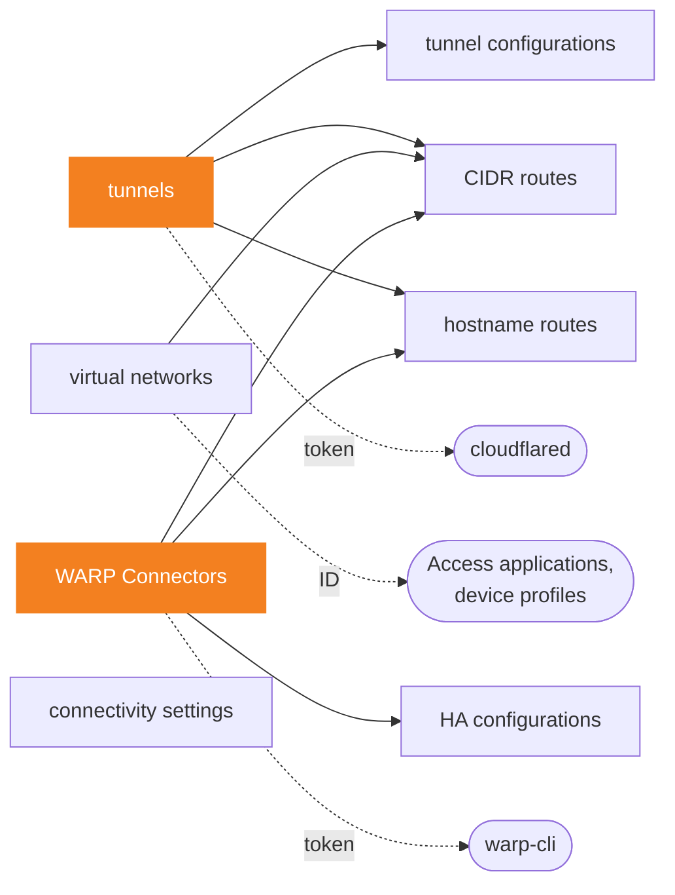

# cloudflare-zero-trust-networks

[](CHANGELOG.md)
[](#requirements)
[](https://registry.terraform.io/providers/cloudflare/cloudflare/latest)
[](../LICENSE)

**The private networks of Cloudflare Zero Trust in one module block:
Cloudflare Tunnels and their configuration, WARP Connectors (Mesh nodes) and
their high availability, virtual networks, CIDR and hostname routes, and the
connectivity settings of the account.**

- 🧩 **The provider, unchanged.** 8 resources, every attribute that is not
  deprecated, under its provider name: hostname routes, the HA modes of WARP
  Connectors and the connectivity settings included. If you know
  `cloudflare/cloudflare`, you already know this module.
- 🔑 **Tokens ready to run.** The tokens of `cloudflared` and of WARP
  Connectors come out as sensitive outputs, read from the provider's own data
  sources: no secret to generate, no credentials file to write.
- 📥 **Adopt what exists.** The import example brings tunnels, their
  configuration, virtual networks and routes under Terraform by name, without
  copying an ID from the dashboard.
- 🔬 **Checked against the real API.** What Cloudflare refuses, rewrites or
  never returns was observed on a Zero Trust organization on the Free plan,
  with provider 5.28.0, and is written here.

> [!IMPORTANT]
> Renaming a key, or changing `config_src` of a tunnel or `ha` of a WARP
> Connector, replaces it: a new ID and a new token. The hosts that run it need
> the new token, and the CNAME records of its public hostnames the new ID.
> Read [Watch out](#watch-out) before your first apply.

**[Quick start](#quick-start)** · **[Inputs](#inputs)** ·
**[Outputs](#outputs)** · **[Watch out](#watch-out)** ·
**[Guides](#guides)** · **[Requirements](#requirements)**

## Quick start

**1. Create the Zero Trust organization** in the Cloudflare One dashboard, if
the account has none: WARP Connectors require one, and so do the devices that
reach private routes. This module does not create it, and is tested with one.

**2. Create an API token** with these account permissions, as the Cloudflare
API schema lists them for each call of the provider, and export it as
`CLOUDFLARE_API_TOKEN`. Grant only those of the inputs you use:

| Permission | Covers |
|---|---|
| Account → Cloudflare Tunnel → Edit | tunnels, their configuration and their tokens, virtual networks, CIDR and hostname routes, and the tokens of WARP Connectors |
| Account → Cloudflare One Connector: WARP → Edit | WARP Connectors and their HA configuration |
| Account → Zero Trust → Edit | `connectivity_settings` |

No Read permission gives a token, and the module reads the tokens at every
plan: a plan needs Cloudflare Tunnel → Edit too, as soon as a tunnel or a WARP
Connector is declared (provider issue
[#7279](https://github.com/cloudflare/terraform-provider-cloudflare/issues/7279)).
The token of a WARP Connector takes Cloudflare Tunnel, not
Cloudflare One Connector: WARP. The module is tested with a broader token:
the schema lists no permission for reading a virtual network or a CIDR route
by ID, which the refresh and the import do, so that read is checked with the
broader token only.

**3. Call the module:**

```hcl
module "networks" {
  source = "github.com/theobs-digital/cloudflare-terraform-modules//cloudflare-zero-trust-networks?ref=cloudflare-zero-trust-networks/v1.0.0"

  account_id = "023e105f4ecef8ad9ca31a8372d0c353"

  tunnel_cloudflareds = {
    office = { name = "office", config_src = "cloudflare" }
  }

  tunnel_cloudflared_configs = {
    office = {
      tunnel_id = module.networks.tunnel_cloudflared_ids["office"]
      config = {
        ingress = [
          { hostname = "wiki.example.com", service = "http://localhost:8080" },
          { service = "http_status:404" },
        ]
      }
    }
  }

  tunnel_cloudflared_routes = {
    office_lan = {
      network   = "192.168.1.0/24"
      tunnel_id = module.networks.tunnel_cloudflared_ids["office"]
    }
  }
}

output "tunnel_id" {
  value = module.networks.tunnel_cloudflared_ids["office"]
}

output "tunnel_token" {
  value     = module.networks.tunnel_cloudflared_tokens["office"]
  sensitive = true
}
```

Find `account_id` in the dashboard, under **API** on a domain's **Overview**
page, or search "Copy account ID" from Account home.

**4. Apply, then run the tunnel** on a host of the office network, and publish
the hostname with a proxied CNAME record `wiki` to
`<tunnel_id>.cfargotunnel.com`:

```bash
export TUNNEL_TOKEN="$(terraform output -raw tunnel_token)"
cloudflared tunnel --no-autoupdate run
```

> [!TIP]
> The module comes from Git, with a release tag in `ref`, see the
> [repository README](../README.md#usage). It is not on the Terraform Registry
> yet.

More in the examples: [basic](examples/basic) (the block above, with what to
do after the apply), [complete](examples/complete) (every input) and
[import](examples/import) (existing tunnels and networks brought under
Terraform without changing them).

### How it works

The module works at the account level. Each input drives one provider
resource, one per entry of a map. Leave an input out, and the module creates
nothing for it; leave `connectivity_settings` out, and the module leaves the
settings of the account alone.

Objects refer to each other through the module's outputs, such as
`tunnel_id = module.networks.tunnel_cloudflared_ids["office"]`: the attribute
keeps the provider's meaning, an ID, whether the object lives in this module
block or elsewhere. A solid arrow goes from an object to those that can refer
to it in the same block, a dotted one to what takes an output outside the
module:



Two consequences, both from how Terraform orders the work, by input and by
output rather than by entry:

- **Terraform creates a route after the tunnel, WARP Connector and virtual
  network it refers to, and deletes it before them**, which Cloudflare
  requires: it refuses to delete a tunnel (error 1023) or a virtual network
  (error 1049) that CIDR routes still use. With an ID written by hand,
  Terraform does not know the link.
- **Every entry of an input waits for every object behind each output its
  entries refer to.** When one of them fails, Terraform creates none of these
  entries: a CIDR route to a WARP Connector makes every CIDR route wait for
  every WARP Connector, and a refused connector holds them all back.

### Why a module

Cloudflare's [Terraform best practices](https://developers.cloudflare.com/terraform/advanced-topics/best-practices/#avoid-modules-or-use-them-sparingly)
advise to avoid modules, or to use them sparingly: a module that hides
resources behind its own logic can change them in ways its caller does not
see, and adds its own bugs to those of Terraform and the provider. This one
has no logic of its own. Each entry is one provider resource, with the
provider's attributes, nothing computed or defaulted on the way, and the plan
shows the provider's resources as they are, under `module.networks`. What the
module adds is the typing of every attribute, the references between
objects, the tokens as outputs, and what this README records of the API.

## Inputs

| Input | Type | Default | Description |
|---|---|---|---|
| `account_id` | `string` | **required** | the account that owns every object of the module |
| `tunnel_cloudflareds` | `map(object)` | `{}` | Cloudflare Tunnels, run by `cloudflared`, see [Tunnels](#tunnels) |
| `tunnel_cloudflared_configs` | `map(object)` | `{}` | ingress rules of tunnels configured from Cloudflare, see [Remote configuration](#remote-configuration) |
| `tunnel_cloudflared_virtual_networks` | `map(object)` | `{}` | separate routing domains, see [Virtual networks](#virtual-networks) |
| `tunnel_cloudflared_routes` | `map(object)` | `{}` | private IP ranges behind a tunnel or a WARP Connector, see [CIDR routes](#cidr-routes) |
| `network_hostname_routes` | `map(object)` | `{}` | private hostnames behind a tunnel or a WARP Connector, see [Hostname routes](#hostname-routes) |
| `tunnel_warp_connectors` | `map(object)` | `{}` | WARP Connectors, Mesh nodes in the dashboard, see [WARP Connectors](#warp-connectors) |
| `tunnel_warp_connector_configs` | `map(object)` | `{}` | how an HA WARP Connector fails over, see [HA configuration](#ha-configuration) |
| `connectivity_settings` | `object` | `null` | ICMP proxy and WARP-to-WARP traffic of the account, see [Connectivity settings](#connectivity-settings) |

The key of a map is yours and only names the object in the Terraform state:
keep it stable, since [renaming it](#rename-a-key) replaces the object, with a
new ID. Each block below shows the attributes an input takes, with what they
do; the full type of every input is in the [Reference](#reference).
Attributes keep their provider names, and whatever you leave out keeps
Cloudflare's default. `account_id` replaces every object of the module when
it changes.

> [!WARNING]
> **A misspelled attribute is dropped without a word.** Terraform discards
> the attributes an input does not declare: `config_scr = "cloudflare"` leaves
> the tunnel `local`, and the plan shows no error. Check the names against the
> blocks on this page.

> [!NOTE]
> **The state holds the secrets**: the tokens the module reads, and the
> `tunnel_secret` you give. Keep the state in an encrypted backend, with
> restricted access. Pass `tunnel_secret` through a sensitive variable, see
> [Tunnel secret](#tunnel-secret).

### Tunnels

```hcl
tunnel_cloudflareds = {
  site_a = {
    name          = "site-a"           # required; changes in place
    config_src    = "cloudflare"       # default local, see below; changing it replaces the tunnel
    tunnel_secret = var.site_a_secret  # default: generated by Cloudflare; changes in place
  }
}
```

**`config_src`** tells where the ingress rules of the tunnel live:

| `config_src` | Ingress rules | `cloudflared` runs with |
|---|---|---|
| `cloudflare` | in Cloudflare, set by [`tunnel_cloudflared_configs`](#remote-configuration) | the token only |
| `local`, the default | in the configuration file of `cloudflared` | the token, and `--config` for the file |

Changing a `config_src` you wrote replaces the tunnel. Write it on every tunnel
configured from Cloudflare, and keep it: left out of a `cloudflare` tunnel,
the plan shows `config_src = "cloudflare" -> "local"` as an in-place update.
Write `config_src` back instead of applying it.

#### Tunnel secret

Left out, `tunnel_secret` is generated by Cloudflare, and the token in
`tunnel_cloudflared_tokens` carries it. To set your own, at least 32 bytes in
base64, such as the output of `openssl rand -base64 32`, mark the secret
sensitive, not the map that holds it: Terraform refuses a sensitive value in
`for_each`, whether the whole map is wrapped in `sensitive()` or the variable
of the module is declared `sensitive`.

```hcl
variable "site_a_secret" {
  type      = string
  sensitive = true
}

module "networks" {
  # ...
  tunnel_cloudflareds = {
    site_a = { name = "site-a", tunnel_secret = var.site_a_secret }
  }
}
```

The provider declares `tunnel_secret` sensitive, so the plan hides it even
when written in clear. Cloudflare never returns it: a secret changed outside
Terraform does not show in the plan. A new secret changes the token, and the
hosts that run the tunnel need the new one.

#### Deleted outside Terraform

Cloudflare keeps a deleted tunnel, and returns it by its ID with `deleted_at`
set: the provider keeps it in the state, and the plan shows no change. Its
token still reads, and an object created for it fails, such as a route, with
`Tunnel not found` (404, error 1002). To create the tunnel again, forget it,
and the next plan creates it, with a new ID:

```bash
terraform state rm 'module.networks.cloudflare_zero_trust_tunnel_cloudflared.this["site_a"]'
```

Cloudflare refuses to delete a tunnel that CIDR routes use, `This tunnel has
private network routes. Please remove all routes before deleting the tunnel.`
(error 1023): delete its routes first.

### Remote configuration

The configuration of a tunnel with `config_src = "cloudflare"`. `cloudflared`
picks a new configuration up while it runs, without a restart.

```hcl
tunnel_cloudflared_configs = {
  site_a = {
    tunnel_id = module.networks.tunnel_cloudflared_ids["site_a"]  # required; changing it replaces the configuration

    config = {
      # Matched in order. The last rule must take every request: service alone.
      ingress = [
        {
          hostname = "app.example.com"        # public hostname, see Publish a hostname
          path     = "^/api/"                 # regular expression on the path
          service  = "https://localhost:8443" # required: http://, https://, unix://, unix+tls://, tcp://, ssh://, rdp://, smb:// or http_status:<code>
          origin_request = {
            # The attributes of origin_request below, for this rule only.
          }
        },
        { service = "http_status:404" },
      ]

      # What every rule inherits. The values shown are cloudflared's defaults.
      origin_request = {
        connect_timeout          = 30     # seconds to open the TCP connection to the origin
        tls_timeout              = 10     # seconds for the TLS handshake with an HTTPS origin
        tcp_keep_alive           = 30     # seconds between TCP keepalive packets to the origin
        keep_alive_timeout       = 90     # seconds before an idle connection is closed
        keep_alive_connections   = 100    # idle connections kept open to the origin
        no_happy_eyeballs        = false  # true: no IPv4/IPv6 fallback
        http_host_header         = ""     # Host header sent to the origin
        origin_server_name       = ""     # hostname expected in the origin certificate
        match_sn_ito_host        = false  # true: take that hostname from the request
        ca_pool                  = ""     # path, on the cloudflared host, of the CA of the origin certificate
        no_tls_verify            = false  # true: accept any origin certificate
        http2_origin             = false  # true: HTTP/2 to an HTTPS origin
        disable_chunked_encoding = false  # true: no chunked transfer encoding, for WSGI servers
        proxy_type               = ""     # "socks": a SOCKS5 proxy instead of the regular one

        # cloudflared checks the Access token of each request.
        access = {
          required  = true                # refuse requests without a valid token
          team_name = "example"           # the team name of the Zero Trust organization
          aud_tag   = ["<aud>"]           # AUDs of the Access applications allowed
        }
      }
    }
  }
}
```

**The last ingress rule must match every request**: `service` alone, without
`hostname` or `path`, such as `http_status:404`. The plan does not check it.
Cloudflare refuses the apply otherwise, with `The last ingress rule must match
all URLs` (error 1056), and keeps the previous configuration.

**`tunnel_id`** takes an ID from `tunnel_cloudflared_ids`, or the ID of a
tunnel created elsewhere. Configure only tunnels with
`config_src = "cloudflare"`: a configuration given to a `local` tunnel turns it
into a `cloudflare` one, and `cloudflared` then follows the configuration from
Cloudflare and ignores the ingress rules of its file. The plan shows nothing,
since the provider keeps `config_src` from the state, and writing
`config_src = "cloudflare"` afterwards replaces the tunnel.

Cloudflare returns the configuration as written, `false` and empty strings
included: a configuration with every attribute set plans no change after the
apply. Leave `source` out: Cloudflare ignores `source = "local"`, and each
plan shows it again.

> [!NOTE]
> **Removing an entry resets nothing.** It only drops the configuration from
> the state: the tunnel keeps it, and `cloudflared` keeps serving it (provider
> issue [#7395](https://github.com/cloudflare/terraform-provider-cloudflare/issues/7395)).
> To change what the tunnel serves, change the entry. A plan that creates or
> removes a configuration warns about "Resource Destruction Considerations",
> which states the same limit. Deleting the tunnel deletes its
> configuration.

### Virtual networks

A virtual network is a separate routing domain: the same CIDR can lead to two
tunnels from two virtual networks. The `tunnel_cloudflared_virtual_network_ids`
output gives their IDs, for the routes of the module and for the private
destinations of Access applications and device profiles.

```hcl
tunnel_cloudflared_virtual_networks = {
  prod = {
    name               = "prod"              # required; changes in place
    comment            = "Production sites"  # default ""; changes in place
    is_default_network = false               # default false; true takes the role from the current default
  }
}
```

#### Default network

Every account has a virtual network named `default`, which takes the routes
created without `virtual_network_id`. To manage it with the module, import it
with the name, the comment and `is_default_network = true` that Cloudflare
returns, and the plan shows no change. Left out, `is_default_network` is
`false` and `comment` is empty, and the plan wants to change them.

```hcl
import {
  to = module.networks.cloudflare_zero_trust_tunnel_cloudflared_virtual_network.this["default"]
  id = "<account_id>/<virtual_network_id>"
}

module "networks" {
  # ...
  tunnel_cloudflared_virtual_networks = {
    default = {
      name               = "default"
      comment            = "This network was autogenerated because this account lacked a default one"
      is_default_network = true
    }
  }
}
```

The comment above is the one Cloudflare gave the `default` network of the
test account: copy the one of yours.

One network at a time is the default. Setting `is_default_network = true` on
another network takes the role from the current one, whose
`is_default_network` turns `false` in Cloudflare: if the module manages it,
the next plan shows the change. Cloudflare refuses to delete the default
network, `Cannot delete the Virtual Network because: it is the default
virtual network` (error 1049): give the role to another network first.

Cloudflare deletes a virtual network only once no route uses it, and refuses
otherwise: `Cannot delete the Virtual Network because: virtual network is used
by 5 IP Route(s)` (error 1049), followed by their CIDRs. The state keeps the
network. Routes that take its ID from the output make the plan fail with
`Invalid index` when the network alone is removed: remove or move those routes
in the same change, and Terraform deletes them first.

### CIDR routes

```hcl
tunnel_cloudflared_routes = {
  site_a_lan = {
    network            = "10.0.0.0/24"                                                     # required
    tunnel_id          = module.networks.tunnel_cloudflared_ids["site_a"]                  # required: a tunnel or a WARP Connector
    virtual_network_id = module.networks.tunnel_cloudflared_virtual_network_ids["prod"]  # default: the default network
    comment            = "Site A LAN"                                                      # default ""
  }
}
```

Every attribute changes in place. `tunnel_id` takes an ID from
`tunnel_cloudflared_ids` or `tunnel_warp_connector_ids`, and
`virtual_network_id` one from `tunnel_cloudflared_virtual_network_ids`, or the
IDs of objects created elsewhere. Removing `virtual_network_id` after it was
set keeps the route in its network, and the plan shows no change: to move the
route back, write the ID of the default network.

A CIDR can be routed once per virtual network. Cloudflare refuses a second
route for it, `You already have a route defined for this exact IP subnet`
(error 1014), and the state keeps the routes as they were.

A route only carries traffic once devices send its range through the
Cloudflare One Client, which leaves private ranges out by default: see
Cloudflare's [Connect an IP/CIDR](https://developers.cloudflare.com/cloudflare-one/networks/connectors/cloudflare-tunnel/private-net/cloudflared/connect-cidr/).
This module does not manage device profiles.

#### Values Cloudflare rewrites

Cloudflare accepts other forms of `network`, but returns them rewritten, and
each plan then shows an in-place update. Write it as Cloudflare stores it:

```diff
  # The first address of the range
- network = "10.0.0.1/24"
+ network = "10.0.0.0/24"

  # A prefix length, even for one address
- network = "10.0.0.5"
+ network = "10.0.0.5/32"

  # IPv6 in its compressed form
- network = "fd00:0001:0000:0000:0000:0000:0000:0000/64"
+ network = "fd00:1::/64"
```

### Hostname routes

A hostname route sends the traffic of a private hostname to a tunnel or a
WARP Connector. It belongs to no virtual network.

```hcl
network_hostname_routes = {
  intranet = {
    hostname  = "intranet.corp.example.com"                       # required
    tunnel_id = module.networks.tunnel_cloudflared_ids["site_a"]  # required: a tunnel or a WARP Connector
    comment   = ""                                                # write "" rather than leave it out, see below
  }
}
```

Every attribute changes in place. The provider leaves `hostname` and
`tunnel_id` optional, but Cloudflare refuses a route without them
(`missing field`, error 1030): the module requires them. A hostname leads to
one tunnel only: Cloudflare refuses a second route for it, `Hostname Route
already routed to another tunnel` (error 1108).

**To remove the comment, write `comment = ""`.** Left out after it was set,
or after an import, the comment is sent as `null`, which Cloudflare answers
with a `500 Internal Server Error`; the state keeps the comment.

Cloudflare stores `hostname` its own way, and treats the forms below as the
same hostname. Write it as Cloudflare stores it, or each plan shows an
in-place update:

```diff
  # Lowercase, without a leading or trailing dot
- hostname = "Intranet.Corp.Example.com."
+ hostname = "intranet.corp.example.com"

  # Without a leading wildcard
- hostname = "*.internal.example.com"
+ hostname = "internal.example.com"
```

A hostname route only carries traffic once the devices use the Gateway proxy
and the tunnel runs `cloudflared` 2025.7.0 or later, see Cloudflare's
[Connect a private hostname](https://developers.cloudflare.com/cloudflare-one/networks/connectors/cloudflare-tunnel/private-net/cloudflared/connect-private-hostname/).

### WARP Connectors

Cloudflare renamed WARP Connector to Cloudflare Mesh in April 2026: the
dashboard lists the connectors as Mesh nodes, under **Networking** > **Mesh**,
while the API and the provider keep `warp_connector`. Cloudflare requires a
Zero Trust organization for them, and accepts them on the Free plan.

```hcl
tunnel_warp_connectors = {
  office = {
    name          = "office"           # required; changes in place
    ha            = false              # default false; set at creation only, see below
    tunnel_secret = var.office_secret  # default: generated by Cloudflare; changes in place
  }
}
```

`tunnel_secret` works as for a [tunnel](#tunnel-secret): a new secret gives a
new token in `tunnel_warp_connector_tokens`. A WARP Connector cannot take the
name of a tunnel of the account: Cloudflare refuses it with `409 Conflict`
(error 1013). Cloudflare documents virtual
networks as not supported by Mesh, although it accepts a route to a WARP
Connector in any virtual network: leave `virtual_network_id` out, and the
route goes to the default network.

#### High availability

`ha = true` creates a connector that several hosts run with the same token:
one replica is active, the others stand by, and Cloudflare promotes one of
them when the active replica disconnects. According to Cloudflare, the hosts
must share a subnet and use the MASQUE protocol, and the failover only covers
the CIDR routes of the connector. How the active replica takes over is the
[HA configuration](#ha-configuration).

Cloudflare sets `ha` at creation only, and changing an `ha` you wrote replaces
the connector. Write it on every HA connector and keep it. Left out, `ha` is
`false`, and the plan shows `ha = true -> false` as an in-place update, which
Cloudflare refuses with `Tunnel not found` (404, error 1002). Applied along
with another change of the connector, such as its name, the update goes
through: Cloudflare ignores `ha` and keeps the connector HA, but the state
records `false` and the next plans show no change. Writing `ha = true`
afterwards replaces the connector. The provider reads `ha` from Cloudflare at
import only.

### HA configuration

How a WARP Connector fails over, one entry per connector. Every connector
has an HA configuration from its creation, `disabled` without `ha`: an entry
overwrites it, without an import.

```hcl
tunnel_warp_connector_configs = {
  datacenter = {
    tunnel_id = module.networks.tunnel_warp_connector_ids["datacenter"]  # required; changing it replaces the configuration
    ha_mode   = "local"                                                  # required: none, local, aws or disabled

    config = {
      vips          = [{ address = "10.3.0.10" }]  # local: 1 to 8 virtual IPs, IPv4 or IPv6
      vips_previous = [{ address = "10.3.0.9" }]   # local: virtual IPs to clean up on demotion
      # fnr_id      = "eni-0123456789abcdef0"      # aws: the network interface that moves on failover
    }
  }
}
```

| `ha_mode` | `config` | Connector |
|---|---|---|
| `none` | left out | HA, without a failover provider: the mode of a new HA connector, according to Cloudflare |
| `local` | `vips`, and `vips_previous` | HA, the active replica takes the virtual IPs on its interface |
| `aws` | `fnr_id` | HA, the AWS network interface moves to the active replica |
| `disabled` | left out | created without `ha` |

Cloudflare checks `config` at the apply, not the plan: it refuses `local`
without `vips` (error 1056), and does not check `fnr_id` against AWS.

Cloudflare refuses any change into or out of `disabled`, `transitions into or
out of 'disabled' are not allowed` (error 1135): a connector created without
`ha` stays `disabled`, and an HA connector cannot be turned to `disabled`.

**To switch between `local` and `aws`, go through `none`**, in two applies. In
a single step, the provider sends the fields of the former mode as `null`,
such as `"vips": null` beside `fnr_id`, and Cloudflare refuses them,
`invalid aws configuration: unknown field vips` (error 1056). The state keeps
the former mode.

Removing an entry only drops it from the state: the connector keeps its mode,
and the plan warns about "Resource Destruction Considerations". The
configuration goes with the connector when the connector is deleted.

### Connectivity settings

Two settings of the whole account. Leave `connectivity_settings` out, and the
module does not touch them.

```hcl
connectivity_settings = {
  icmp_proxy_enabled   = false  # true: devices can ping and traceroute private addresses
  offramp_warp_enabled = false  # true: WARP-to-WARP traffic
}
```

**`icmp_proxy_enabled`** is the **ICMP** box of **Allow Secure Web Gateway to
proxy traffic**, in **Traffic policies** > **Traffic settings**.
**`offramp_warp_enabled`** is WARP-to-WARP traffic, as the API reference
calls it: the former **Allow WARP to WARP connection**, in **Team & Resources**
> **Devices** > **Management** > **Peer to peer connectivity**, which
Cloudflare's Mesh documentation now calls **Allow all Cloudflare One traffic
to reach enrolled devices**. The dashboard of the test account showed neither
on 18 October 2026: the setting is checked on the API only.

Every account has these settings, and the provider only updates them: the
first apply writes them over the current ones. To start from the current
values, import them, and write the values the plan shows:

```hcl
import {
  to = module.networks.cloudflare_zero_trust_connectivity_settings.this[0]
  id = "<account_id>"
}
```

**Write both settings and keep them.** Removing one sends it as `null`, which
Cloudflare answers with a `500 Internal Server Error` (error 1000) and keeps
its value: each plan then shows the change again. Removing
`connectivity_settings` only drops the settings from the state: Cloudflare
keeps their last values, and the plan warns about "Resource Destruction
Considerations". Remove the `import` block with it: Terraform refuses an
import whose target is no longer in the configuration.

## Outputs

| Output | Use it for |
|---|---|
| `tunnel_cloudflared_tokens` | 👉 the hosts: `cloudflared tunnel run`, see [Run the tunnel](#run-the-tunnel). Sensitive |
| `tunnel_warp_connector_tokens` | 👉 the hosts: `warp-cli connector new`, see [Run a WARP Connector](#run-a-warp-connector). Sensitive |
| `tunnel_cloudflared_ids` | `tunnel_id` of configurations and routes; CNAME records to `<id>.cfargotunnel.com`, see [Publish a hostname](#publish-a-hostname) |
| `tunnel_cloudflared_virtual_network_ids` | `virtual_network_id` of routes; private destinations of Access applications, device profiles |
| `tunnel_warp_connector_ids` | `tunnel_id` of HA configurations and routes |
| `tunnel_cloudflared_route_ids` | the IDs of the CIDR routes |
| `network_hostname_route_ids` | the IDs of the hostname routes |

Each output is a map by key of its input. The configurations have no ID
output, since their ID is their tunnel's. The module reads the tokens at each
plan.

## Watch out

**🔴 Can cut off a site or its users**

- **Renaming a key, or changing `config_src` of a tunnel, `ha` of a WARP
  Connector, or `account_id`**, replaces the object: a new ID and a new token.
  Declare the move, see [Rename a key](#rename-a-key).
- **A configuration given to a `local` tunnel** turns it into a `cloudflare`
  one: `cloudflared` drops the ingress rules of its file, and the plan shows
  nothing. See [Remote configuration](#remote-configuration).

**🟠 Surprises at apply**

- **An ingress without a last rule that takes every request** passes the plan,
  and fails at apply (error 1056).
- **Deleting a tunnel** fails while `cloudflared` runs it, or while CIDR
  routes use it (error 1023): stop `cloudflared` first. A tunnel deleted
  outside Terraform stays in the state, and the plan shows no change: see
  [Deleted outside Terraform](#deleted-outside-terraform).
- **Deleting a virtual network** fails while routes use it, or while it is the
  default (error 1049). **`is_default_network = true`** takes the role from
  the current default: the routes created without `virtual_network_id` then
  go to the new one. See [Default network](#default-network).
- **The same CIDR twice in a virtual network** (error 1014), **the same
  hostname twice** (error 1108), **the name of a tunnel for a WARP
  Connector** (error 1013).
- **A change of HA mode** into or out of `disabled` (error 1135), or between
  `local` and `aws` in one step (error 1056). See
  [HA configuration](#ha-configuration).
- **Leaving out** `ha` of an HA connector (404, `Tunnel not found`),
  `comment` of a hostname route or a field of `connectivity_settings`
  (`500 Internal Server Error`): write them. `config_src` left out of a
  `cloudflare` tunnel plans an update to `local`: write it back.
- **A misspelled attribute** is dropped without an error: see [Inputs](#inputs).

**🟡 A change at every plan**

- A `network` or a `hostname` written in another form than the one Cloudflare
  stores: see [Values Cloudflare rewrites](#values-cloudflare-rewrites) and
  [Hostname routes](#hostname-routes).
- `source = "local"` in a tunnel configuration: leave `source` out.
- A field removed from `connectivity_settings`, which Cloudflare keeps.

**🔵 Harmless, good to know**

- Removing a tunnel configuration, an HA configuration or
  `connectivity_settings` resets nothing in Cloudflare, and their plans warn
  about "Resource Destruction Considerations".
- An ingress rule with a `hostname` creates no DNS record: see
  [Publish a hostname](#publish-a-hostname).
- Cloudflare keeps deleted objects. A deleted tunnel or WARP Connector stays
  readable by its ID, with `deleted_at` set; the lists of the API leave
  deleted objects out.

**🐞 Known provider issues**, open on 18 October 2026, and what the tests of
this module saw with provider 5.28.0:

| Issue | Reported | Seen here |
|---|---|---|
| [#7395](https://github.com/cloudflare/terraform-provider-cloudflare/issues/7395) | Destroying a tunnel configuration leaves its ingress rules live (5.25.0). | The same: removing an entry of `tunnel_cloudflared_configs` sends no request. See [Remote configuration](#remote-configuration). |
| [#7279](https://github.com/cloudflare/terraform-provider-cloudflare/issues/7279) | Reading a tunnel token fails with 401 with Cloudflare Tunnel → Read only (5.22.0). | The API schema accepts only Edit permissions for a token: see [Quick start](#quick-start). |
| [#7417](https://github.com/cloudflare/terraform-provider-cloudflare/issues/7417) | The data sources of WARP Connectors, `cloudflare_zero_trust_tunnel_warp_connectors` and `cloudflare_zero_trust_tunnel_warp_connector` with `filter`, fail with `RFC3339 string value is null` unless `was_active_at` and `was_inactive_at` are both set (5.28.0). | Reported from these tests. With both set, Cloudflare only returns the connectors active at `was_active_at`: no data source finds a connector by name. The [import example](examples/import) takes the IDs of WARP Connectors instead. |
| [#7418](https://github.com/cloudflare/terraform-provider-cloudflare/issues/7418) | Removing an optional attribute sends it as `null`, which Cloudflare refuses: `comment` of a hostname route and a field of `connectivity_settings` (500), the fields of the former mode of an HA configuration (error 1056) (5.28.0). | Reported from these tests: write `comment = ""` and both settings, and switch between `local` and `aws` through `none`. See [Hostname routes](#hostname-routes), [Connectivity settings](#connectivity-settings) and [HA configuration](#ha-configuration). |
| [#7419](https://github.com/cloudflare/terraform-provider-cloudflare/issues/7419) | Removing `ha` from an HA WARP Connector plans an in-place update that Cloudflare refuses with `Tunnel not found`, and `ha` is never read back once the state holds a value (5.28.0). | Reported from these tests: write `ha` and keep it, see [High availability](#high-availability). |

## Guides

### Run the tunnel

The `tunnel_cloudflared_tokens` output gives the token of each tunnel, by
key. Pass it to `cloudflared` through the `TUNNEL_TOKEN` environment
variable, which keeps it out of the process list:

```bash
export TUNNEL_TOKEN="$(terraform output -json tunnel_cloudflared_tokens | jq -r .site_a)"
cloudflared tunnel --no-autoupdate run
```

The same command runs a `local` tunnel: `cloudflared` then reads its ingress
rules from its configuration file, given with `--config`. Several hosts can
run a tunnel with the same token, as replicas.

### Publish a hostname

An ingress rule with a `hostname` creates no DNS record. To serve the
hostname, add a proxied CNAME record to `<id>.cfargotunnel.com`, for instance
with the [`cloudflare-dns`](../cloudflare-dns) module:

```hcl
module "dns" {
  # ...
  records = {
    app = {
      name    = "app"
      type    = "CNAME"
      content = "${module.networks.tunnel_cloudflared_ids["site_a"]}.cfargotunnel.com"
      proxied = true
    }
  }
}
```

### Run a WARP Connector

The `tunnel_warp_connector_tokens` output gives the token of each connector,
by key. According to Cloudflare, a Linux host with the Cloudflare One Client,
the `cloudflare-warp` package, registers with it:

```bash
sudo warp-cli --accept-tos connector new "$(terraform output -json tunnel_warp_connector_tokens | jq -r .office)"
sudo warp-cli --accept-tos connect
```

The host also needs a device enrollment rule, a device profile and device
settings, which this module does not manage, see
[Required account settings](https://developers.cloudflare.com/mesh/get-started/#required-account-settings).
The module is tested on the API only: no host was registered with these
tokens.

### Adopt an existing setup

To bring tunnels and their configuration, virtual networks, routes and WARP
Connectors under the module without changing them, follow the
[import example](examples/import): `import` blocks, with each object looked
up by name, network or hostname in the provider's data sources. For the other
inputs, write an `import` block by hand, with the ID below. `import` blocks
need Terraform 1.5 or later; before, run `terraform import` with the same
address and ID.

| Input | Import ID | After the import, the plan shows |
|---|---|---|
| `tunnel_cloudflareds` | `<account>/<tunnel id>` | `config_src` to `local`, unless you write `cloudflare`. Leave `tunnel_secret` out: never returned |
| `tunnel_cloudflared_configs` | `<account>/<tunnel id>` | no change, once the configuration is written as it is |
| `tunnel_cloudflared_virtual_networks` | `<account>/<id>` | no change. The `default` network: see [Default network](#default-network) |
| `tunnel_cloudflared_routes` | `<account>/<id>` | no change |
| `network_hostname_routes` | `<account>/<id>` | `comment` to `null` when left out, which Cloudflare refuses: write `""` |
| `tunnel_warp_connectors` | `<account>/<id>` | `ha` to `false` on an HA connector, unless you write `true` |
| `tunnel_warp_connector_configs` | `<account>/<connector id>` | no change, once `ha_mode` and `config` are written as they are |
| `connectivity_settings` | `<account>` | no change, once both settings are written as they are |

```hcl
import {
  to = module.networks.cloudflare_zero_trust_tunnel_warp_connector_config.this["datacenter"]
  id = "023e105f4ecef8ad9ca31a8372d0c353/86f12620-7e53-4157-bc04-14560ee40cfb"
}
```

### Move resources into the module

When your configuration already manages these objects as its own resources,
such as `resource "cloudflare_zero_trust_tunnel_cloudflared" "site_a"`,
replacing them with the module makes the plan destroy each object and create
it again: a new ID and a new token. Declare each move instead, from your
resource to the module's, under the key of its entry:

```hcl
moved {
  from = cloudflare_zero_trust_tunnel_cloudflared.site_a
  to   = module.networks.cloudflare_zero_trust_tunnel_cloudflared.this["site_a"]
}

moved {
  from = cloudflare_zero_trust_tunnel_cloudflared_virtual_network.prod
  to   = module.networks.cloudflare_zero_trust_tunnel_cloudflared_virtual_network.this["prod"]
}
```

The plan then shows each object as "has moved to", and no change once the
entries carry the attributes of your resources. The resources are
`cloudflare_zero_trust_<kind>.this`, listed in the [Reference](#reference).
Resources of provider 4, such as `cloudflare_tunnel`, have another type:
`terraform state mv` fails between them (provider issue
[#7283](https://github.com/cloudflare/terraform-provider-cloudflare/issues/7283)).
Import their objects into the module instead, as in the
[import example](examples/import).

### Rename a key

Renaming a key deletes the object and creates it again. To rename a key
without touching Cloudflare, declare the move:

```hcl
moved {
  from = module.networks.cloudflare_zero_trust_tunnel_cloudflared.this["old"]
  to   = module.networks.cloudflare_zero_trust_tunnel_cloudflared.this["new"]
}
```

Move the configuration with its tunnel, and the HA configuration with its
connector, when they share its key.

### Stop managing without deleting

**The whole module.** Remove the `module` block and declare its removal
(Terraform 1.7 or later). The plan then shows each object as "will no longer
be managed by Terraform, but will not be destroyed". Before Terraform 1.7,
run `terraform state rm module.networks` instead.

```hcl
removed {
  from = module.networks

  lifecycle {
    destroy = false
  }
}
```

**One object.** A `removed` block cannot target one key of an input: forget
it with `terraform state rm`, then remove its entry.

```bash
terraform state rm 'module.networks.cloudflare_zero_trust_tunnel_cloudflared.this["site_a"]'
```

## Requirements

| | Version | Checked with |
|---|---|---|
| Terraform | `>= 1.3`, the first with optional object attributes | 1.3.10 and 1.16.5 |
| Provider [`cloudflare/cloudflare`](https://registry.terraform.io/providers/cloudflare/cloudflare/latest) | `~> 5.28`; `connectivity_settings` needs 5.26, and 5.27 reads `ha` of an imported WARP Connector | 5.28.0 |

`import` blocks need Terraform 1.5 or later, and `removed` blocks and the
[import example](examples/import) 1.7. The provider reads its API token from
the `CLOUDFLARE_API_TOKEN` environment variable, with the permissions listed
in [Quick start](#quick-start).

## Reference

<details>
<summary><b>Every input and output, with its full type</b> (generated by terraform-docs)</summary>

<!-- BEGIN_TF_DOCS -->
### Resources

The following resources are used by this module:

- [cloudflare_zero_trust_connectivity_settings.this](https://registry.terraform.io/providers/cloudflare/cloudflare/latest/docs/resources/zero_trust_connectivity_settings) (resource)
- [cloudflare_zero_trust_network_hostname_route.this](https://registry.terraform.io/providers/cloudflare/cloudflare/latest/docs/resources/zero_trust_network_hostname_route) (resource)
- [cloudflare_zero_trust_tunnel_cloudflared.this](https://registry.terraform.io/providers/cloudflare/cloudflare/latest/docs/resources/zero_trust_tunnel_cloudflared) (resource)
- [cloudflare_zero_trust_tunnel_cloudflared_config.this](https://registry.terraform.io/providers/cloudflare/cloudflare/latest/docs/resources/zero_trust_tunnel_cloudflared_config) (resource)
- [cloudflare_zero_trust_tunnel_cloudflared_route.this](https://registry.terraform.io/providers/cloudflare/cloudflare/latest/docs/resources/zero_trust_tunnel_cloudflared_route) (resource)
- [cloudflare_zero_trust_tunnel_cloudflared_virtual_network.this](https://registry.terraform.io/providers/cloudflare/cloudflare/latest/docs/resources/zero_trust_tunnel_cloudflared_virtual_network) (resource)
- [cloudflare_zero_trust_tunnel_warp_connector.this](https://registry.terraform.io/providers/cloudflare/cloudflare/latest/docs/resources/zero_trust_tunnel_warp_connector) (resource)
- [cloudflare_zero_trust_tunnel_warp_connector_config.this](https://registry.terraform.io/providers/cloudflare/cloudflare/latest/docs/resources/zero_trust_tunnel_warp_connector_config) (resource)
- [cloudflare_zero_trust_tunnel_cloudflared_token.this](https://registry.terraform.io/providers/cloudflare/cloudflare/latest/docs/data-sources/zero_trust_tunnel_cloudflared_token) (data source)
- [cloudflare_zero_trust_tunnel_warp_connector_token.this](https://registry.terraform.io/providers/cloudflare/cloudflare/latest/docs/data-sources/zero_trust_tunnel_warp_connector_token) (data source)

### Required Inputs

The following input variables are required:

#### <a name="input_account_id"></a> [account\_id](#input\_account\_id)

Description: ID of the Cloudflare account that owns the tunnels, WARP Connectors and networks. Changing it replaces every resource of the module.

Type: `string`

### Optional Inputs

The following input variables are optional (have default values):

#### <a name="input_connectivity_settings"></a> [connectivity\_settings](#input\_connectivity\_settings)

Description: Connectivity settings of the account, with the attributes of `cloudflare_zero_trust_connectivity_settings` under the same names. When `null`, the module leaves them alone. Write both and keep them: one left out after it was set is sent as `null`, which Cloudflare refuses. Removing this argument resets nothing, see [Connectivity settings](#connectivity-settings).

Type:

```hcl
object({
    icmp_proxy_enabled   = optional(bool)
    offramp_warp_enabled = optional(bool)
  })
```

Default: `null`

#### <a name="input_network_hostname_routes"></a> [network\_hostname\_routes](#input\_network\_hostname\_routes)

Description: Hostname routes to tunnels and WARP Connectors, by a key of your choice, with the attributes of `cloudflare_zero_trust_network_hostname_route` under the same names. Cloudflare requires `hostname` and `tunnel_id`, which the provider leaves optional. `tunnel_id` takes an ID from the `tunnel_cloudflared_ids` or `tunnel_warp_connector_ids` output, or the ID of a tunnel created elsewhere. Write `hostname` as Cloudflare returns it: lowercase, without a trailing dot or a leading `*.`. To remove `comment`, write `""`, see [Hostname routes](#hostname-routes).

Type:

```hcl
map(object({
    hostname  = string
    tunnel_id = string
    comment   = optional(string)
  }))
```

Default: `{}`

#### <a name="input_tunnel_cloudflared_configs"></a> [tunnel\_cloudflared\_configs](#input\_tunnel\_cloudflared\_configs)

Description: Remote configurations of tunnels, by a key of your choice, with the attributes of `cloudflare_zero_trust_tunnel_cloudflared_config` under the same names. `tunnel_id` takes an ID from the `tunnel_cloudflared_ids` output, or the ID of a tunnel created elsewhere, with `config_src = "cloudflare"`. The rules of `config.ingress` are matched in order, and the last one must match every request: `service` alone, such as `http_status:404`. The timeouts of `origin_request` are in seconds. Leave `source` out. Removing an entry leaves its configuration in Cloudflare, see [Remote configuration](#remote-configuration).

Type:

```hcl
map(object({
    tunnel_id = string
    config = optional(object({
      ingress = optional(list(object({
        service  = string
        hostname = optional(string)
        origin_request = optional(object({
          access = optional(object({
            aud_tag   = list(string)
            team_name = string
            required  = optional(bool)
          }))
          ca_pool                  = optional(string)
          connect_timeout          = optional(number)
          disable_chunked_encoding = optional(bool)
          http2_origin             = optional(bool)
          http_host_header         = optional(string)
          keep_alive_connections   = optional(number)
          keep_alive_timeout       = optional(number)
          match_sn_ito_host        = optional(bool)
          no_happy_eyeballs        = optional(bool)
          no_tls_verify            = optional(bool)
          origin_server_name       = optional(string)
          proxy_type               = optional(string)
          tcp_keep_alive           = optional(number)
          tls_timeout              = optional(number)
        }))
        path = optional(string)
      })))
      origin_request = optional(object({
        access = optional(object({
          aud_tag   = list(string)
          team_name = string
          required  = optional(bool)
        }))
        ca_pool                  = optional(string)
        connect_timeout          = optional(number)
        disable_chunked_encoding = optional(bool)
        http2_origin             = optional(bool)
        http_host_header         = optional(string)
        keep_alive_connections   = optional(number)
        keep_alive_timeout       = optional(number)
        match_sn_ito_host        = optional(bool)
        no_happy_eyeballs        = optional(bool)
        no_tls_verify            = optional(bool)
        origin_server_name       = optional(string)
        proxy_type               = optional(string)
        tcp_keep_alive           = optional(number)
        tls_timeout              = optional(number)
      }))
    }))
    source = optional(string)
  }))
```

Default: `{}`

#### <a name="input_tunnel_cloudflared_routes"></a> [tunnel\_cloudflared\_routes](#input\_tunnel\_cloudflared\_routes)

Description: CIDR routes to tunnels and WARP Connectors, by a key of your choice, with the attributes of `cloudflare_zero_trust_tunnel_cloudflared_route` under the same names. `tunnel_id` takes an ID from the `tunnel_cloudflared_ids` or `tunnel_warp_connector_ids` output, and `virtual_network_id` one from `tunnel_cloudflared_virtual_network_ids`, or the IDs of objects created elsewhere. Write `network` as Cloudflare returns it, such as `10.0.0.0/24`. Left out, `virtual_network_id` is the default network of the account, see [CIDR routes](#cidr-routes).

Type:

```hcl
map(object({
    network            = string
    tunnel_id          = string
    comment            = optional(string)
    virtual_network_id = optional(string)
  }))
```

Default: `{}`

#### <a name="input_tunnel_cloudflared_virtual_networks"></a> [tunnel\_cloudflared\_virtual\_networks](#input\_tunnel\_cloudflared\_virtual\_networks)

Description: Virtual networks, by a key of your choice, with the attributes of `cloudflare_zero_trust_tunnel_cloudflared_virtual_network` under the same names. Left out, `is_default_network` is `false`: to import the default network of the account, write `true`, see [Default network](#default-network).

Type:

```hcl
map(object({
    name               = string
    comment            = optional(string)
    is_default_network = optional(bool)
  }))
```

Default: `{}`

#### <a name="input_tunnel_cloudflareds"></a> [tunnel\_cloudflareds](#input\_tunnel\_cloudflareds)

Description: Cloudflare Tunnels run by `cloudflared`, by a key of your choice. The key only names the tunnel in the state: keep it stable, since renaming a key replaces the tunnel. Each tunnel takes the attributes of `cloudflare_zero_trust_tunnel_cloudflared` under the same names. Set `config_src = "cloudflare"` for a tunnel configured by `tunnel_cloudflared_configs`; left out, it is `local`, and `cloudflared` reads its configuration file. Changing `config_src` replaces the tunnel. Left out, `tunnel_secret` is generated by Cloudflare; pass your own from a sensitive variable, see [Tunnel secret](#tunnel-secret).

Type:

```hcl
map(object({
    name          = string
    config_src    = optional(string)
    tunnel_secret = optional(string)
  }))
```

Default: `{}`

#### <a name="input_tunnel_warp_connector_configs"></a> [tunnel\_warp\_connector\_configs](#input\_tunnel\_warp\_connector\_configs)

Description: High availability configurations of WARP Connectors, by a key of your choice, with the attributes of `cloudflare_zero_trust_tunnel_warp_connector_config` under the same names. `tunnel_id` takes an ID from the `tunnel_warp_connector_ids` output, or the ID of a connector created elsewhere; changing it replaces the configuration. `config` depends on `ha_mode`: `fnr_id` for `aws`, `vips` for `local`, nothing for `none` and `disabled`. Cloudflare refuses any change into or out of `disabled`, and a switch between `local` and `aws` that does not go through `none`. Removing an entry leaves its configuration in Cloudflare, see [HA configuration](#ha-configuration).

Type:

```hcl
map(object({
    ha_mode   = string
    tunnel_id = string
    config = optional(object({
      fnr_id = optional(string)
      vips = optional(list(object({
        address = string
      })))
      vips_previous = optional(list(object({
        address = string
      })))
    }))
  }))
```

Default: `{}`

#### <a name="input_tunnel_warp_connectors"></a> [tunnel\_warp\_connectors](#input\_tunnel\_warp\_connectors)

Description: WARP Connectors, called Mesh nodes in the dashboard, by a key of your choice, with the attributes of `cloudflare_zero_trust_tunnel_warp_connector` under the same names. The key only names the connector in the state: keep it stable, since renaming a key replaces the connector. `ha` is only set at creation, and changing it replaces the connector: write it on every HA connector and keep it, see [High availability](#high-availability). Left out, `tunnel_secret` is generated by Cloudflare.

Type:

```hcl
map(object({
    name          = string
    ha            = optional(bool)
    tunnel_secret = optional(string)
  }))
```

Default: `{}`

### Outputs

The following outputs are exported:

#### <a name="output_network_hostname_route_ids"></a> [network\_hostname\_route\_ids](#output\_network\_hostname\_route\_ids)

Description: IDs of the hostname routes, by key of `network_hostname_routes`.

#### <a name="output_tunnel_cloudflared_ids"></a> [tunnel\_cloudflared\_ids](#output\_tunnel\_cloudflared\_ids)

Description: IDs of the tunnels, by key of `tunnel_cloudflareds`. A public hostname of a tunnel needs a CNAME record to `<id>.cfargotunnel.com`.

#### <a name="output_tunnel_cloudflared_route_ids"></a> [tunnel\_cloudflared\_route\_ids](#output\_tunnel\_cloudflared\_route\_ids)

Description: IDs of the CIDR routes, by key of `tunnel_cloudflared_routes`.

#### <a name="output_tunnel_cloudflared_tokens"></a> [tunnel\_cloudflared\_tokens](#output\_tunnel\_cloudflared\_tokens)

Description: Tokens that run the tunnels with `cloudflared tunnel run`, by key of `tunnel_cloudflareds`. See [Run the tunnel](#run-the-tunnel).

#### <a name="output_tunnel_cloudflared_virtual_network_ids"></a> [tunnel\_cloudflared\_virtual\_network\_ids](#output\_tunnel\_cloudflared\_virtual\_network\_ids)

Description: IDs of the virtual networks, by key of `tunnel_cloudflared_virtual_networks`, for the `virtual_network_id` of routes, Access applications and device profiles.

#### <a name="output_tunnel_warp_connector_ids"></a> [tunnel\_warp\_connector\_ids](#output\_tunnel\_warp\_connector\_ids)

Description: IDs of the WARP Connectors, by key of `tunnel_warp_connectors`, for the `tunnel_id` of their HA configuration and of CIDR and hostname routes.

#### <a name="output_tunnel_warp_connector_tokens"></a> [tunnel\_warp\_connector\_tokens](#output\_tunnel\_warp\_connector\_tokens)

Description: Tokens that register hosts as WARP Connectors with `warp-cli connector new`, by key of `tunnel_warp_connectors`. See [Run a WARP Connector](#run-a-warp-connector).
<!-- END_TF_DOCS -->

</details>

## Development

See the [repository README](../README.md#development) for the tools and the
checks.
